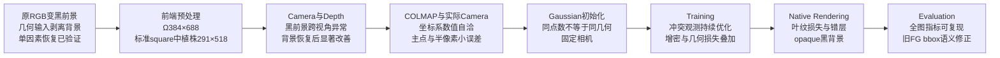
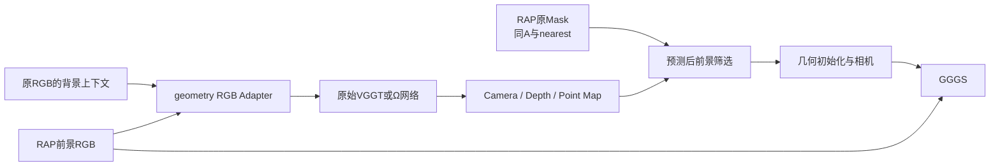

# ForeSplat KongQueZhuYu 端到端根因审计

审计日期：2026-11-08。对象为已完成的 E1–E6、三组无融合对照和既有七份前端 Bundle。主证据来自保存的208帧预测、实际训练日志/源码、最终PLY与真正Checkpoint重渲染。旧实验保持原样；新产物都在本目录。GPU任务仅使用物理GPU1，经uv调用已有隔离环境，没有conda、全局依赖升级或新增Gaussian训练。

## 1. Executive Summary

**最强的已确认触发因素，是在几何推理之前把原RGB背景剥离，仅将RAP黑色前景合成图送入VGGT/Ω。**固定24帧、原始Mask内RGB、Mask、权重、顺序、尺寸、随机种子和推理实现，只恢复Mask外原背景，两种网络的相机与前景几何都从严重失配恢复到近像素一致。这是实际单因素干预，不能继续把旧黑前景结果差直接归因于VGGT架构。

| 固定24帧、同12对相邻原source、同一前景RGB匹配 | Ω黑前景 → 背景恢复 | 标准VGGT黑前景 → 背景恢复 |
|---|---:|---:|
| Sampson极线误差，逐pair中位数 | 9.802 → **0.548 px** | 37.150 → **0.440 px** |
| 源depth投到独立目标RGB的误差 | 23.300 → **1.170 px** | 117.290 → **1.276 px** |
| 5%跨视角depth支持率 | 52.69% → **92.03%** | 23.78% → **92.98%** |

Mask内原始像素改动为0，匹配仍取同一份RAP前景特征，不是用背景特征替换了评价点。上述结果仅证明这一24帧条件的几何改善；**全208新输入与修正后30k Gaussian重训未执行，最终模糊改善幅度还未验证**。视觉参照/背景上下文丢失是与控制一致的机制解释，未通过神经网络attention归因宣称唯一内部机制。

保存的208帧预测则表明，显著错误已经发生在Camera/Depth阶段，先于COLMAP导出和最终评价。标准VGGT这次黑前景条件的问题更严重，Ω也没有通过精确相机验收。固定这些相机后，GGGS/2DGS在冲突观测下优化Gaussian；当前模糊在浮点Checkpoint渲染中确实存在。

三类独立检查支撑这个定位：

- **不使用预测深度的RGB匹配**：同69组相邻视角、同一批图像RANSAC内点，预测极线Sampson误差逐pair中位数Ω3.001、标准23.531共享网格像素；标准64/69对更差。不是单视角反投影自检。
- **独立目标RGB匹配＋保存源深度**：共同14组相邻pair的目标像素投影误差Ω8.013、标准111.264像素；高置信度过滤没有消除失配。保存深度的跨视角5%一致性支持率Ω77.73%、标准22.06%。
- **实际相机序列**：Ω有2次、标准12次相邻旋转超过90°，对应输入照片仍是连续采集；焦距/相对位姿2×2控制表明，仅给标准相机换Ω焦距仍留下19.897px极线误差，相对位姿是重要因素。

这些数值均使用同一384×688查询坐标，不能直接称为1080×1920训练像素或毫米误差。重复叶纹、非刚体运动和图像匹配误差仍存在，故本报告确认的是实际数据条件中的几何观测冲突，以及背景输入恢复对24帧的因果改善；不把它扩展成VGGT架构在所有场景失效，也没有量化各因素对最终PSNR的百分比贡献。

相机冲突被Gaussian颜色、位置、尺度和透明度部分吸收，是固定相机源码、实际错层/模糊渲染与后期增密共同支持的**误差传播推断**。本轮尚未完成全208相机校正后的单因素30k重训，因此不把这条解释写成已测得全部模糊的唯一因果或具体百分比。

GGGS确实丢弃主点，标准预处理A也确实遗漏PIL半像素中心项；它们应修复，但真实训练像素偏移只有Ω1.98、标准2.62px。小主点位移控制没有恢复清晰度。E5的5.15M主要增长在7k–15k，伴随非常小的Gaussian和raw/filtered opacity不一致；**删除64.94%的低filtered-alpha点仍未改善模糊**。因此，“主点丢失就是全部原因”或“五百万点太多就是根因”都不足以解释实测。

旧全图PSNR/SSIM被同源浮点重渲染精确复现，排除了旧PNG或指标代码制造模糊。旧FG指标实际是整个Mask包围框，已经另存真正Mask区域指标；原结果未覆盖。原RGB在Mask内部与RAP几乎逐像素一致，但Mask边缘存在局部遗漏，标准前端square策略的实际植株像素更少；这些是需要独立区分的输入条件。标准初始PLY首/末两帧共512个实际RGB颜色与同像素模型输入全部相同，未检出RGB/BGR交换。

需要修正的旧判断：

- 标准VGGT在两个后端都约13dB，首先证明共同黑前景几何条件有问题；背景恢复后的强改善否定了据此认定其网络固有能力差。
- 两套SfM注册208/208只说明组织/注册完成，不证明像素相机精度；现有独立对应未支持它们立即替代Ω。
- E5点数膨胀是需要追踪的优化现象，删除大多数低effective点没有救blur；不能把数量本身当直接病因。
- 旧FG指标、SH0说明和E3/E4 final状态有语义/配置记录偏差，已在新报告纠正；没有修改或抹掉旧实验。

## 2. Root Cause Ranking

状态针对表内明确命题，不把源码漏洞、终点现象和历史因果混成同一个结论。编号对应 [evidence_summary.csv](evidence_summary.csv)。

| 优先级 | 候选根因/命题 | 实测和触发条件 | 影响范围 | 结论 |
|---|---|---|---|---|
| P0 | 几何推理使用去背景RGB，缺少独立geometry RGB来源 | Ω `discovery.py:93–131`收集crop；`full_sequence.py:102–108,334–341`将同image_path送模型；Standard `run_standard_vggt_frontend.py:43,106–123`继承E1 Dataset。24帧仅恢复Mask外：极线9.802/37.150→.548/.440px | 黑前景前端条件，传播至E1–E6的错误相机/初始化；24帧直接干预成立 | **Confirmed**输入触发；depth支持52.69/23.78→92.03/92.98%；全208与最终GS收益 **Unresolved** |
| P0 | 保存相机/几何不能支持真实跨视角RGB | 208帧黑前景输入；同69近邻pair标准23.531px、Ω3.001px；两者都有旋转异常；目标RGB跨投影更差 | 标准E5/E6共同条件，ΩE1–E4也有局部缺陷 | **Confirmed**：训练前观测失配；是输入问题的后续表现，非独立证明网络固有瓶颈 |
| P0 | 标准问题仅由焦距差异导致 | 保持主点与匹配，Standard pose+Ω focal仍19.897px；Ω pose+Ω focal4.345px | E5/E6相机 | **Rejected**：焦距单独替换不能恢复；相对位姿因素明确 |
| P1 | GGGS丢主点＋标准A遗漏半像素 | `dataset_readers.py:141/146`，`cameras.py:48`，`graphics_utils.py:72`；`vggt_foreground/preprocess.py:40`；全208实际矩阵核验 | E1–E6；标准A影响E5/E6 | **Confirmed**接口缺陷；**Rejected**作为数十像素失配的充分解释 |
| P1 | 错误相机条件在固定相机训练中持续产生冲突 | `train_foresplat.py:189–258`相机只读、优化Gaussian；7k后NCC非零；E5高NCC/差RGB持续至30k | E1–E5，E6也固定同标准相机 | **Confirmed**优化条件和冲突现象；各损失的历史因果比例 **Unresolved** |
| P1 | E5增密/剪枝使补偿点大量存活 | `gaussian_model.py:721–801` absolute分支、raw-only prune、未用max_screen_size；E5σ/extent中位.000105807，59.29% raw≥.05却filtered<.05 | E5最显著，GGGS核心E1–E5共用 | **Confirmed**机制与参数分布；历史Q=0触发 **Unresolved** |
| P1 | 低filtered-alpha点过多是模糊的直接修复入口 | 固定相机/RGB/剩余参数删除E5 64.94%，真FGPSNR变化−.09265dB，opaque背景几乎不变 | E1/E5三共同训练视角 | **Rejected**这条终点阈值删除修复 |
| P1 | 黑色RGB允许不透明背景被拟合 | native BG alpha>.5：E1/E5/E6分别91.94/95.55/99.54%；E3既有前景条件减少背景alpha但边缘更差 | 三后端真实checkpoint | **Confirmed**空间解释退化；作为唯一叶片模糊原因 **Unresolved** |
| P2 | RAP导致全局前景RGB插值模糊 | 18固定视角Mask内最大MAE.00721/255，最低逐位一致99.999713%；人工GT Mask边界局部遗漏 | 各实验共同输入 | 全局RGB模糊 **Rejected**；局部Mask缺损 **Confirmed** |
| P2 | E1/E5后端GT、分辨率或COLMAP坐标轴不同 | 所有RGB/Mask hardlink相同，实际1080×1920；原/导出点相机数值闭合，runtime矩阵也闭合 | E1/E5/E6 | **Rejected**主要解释；前端采样策略仍不同 |
| P2 | 初始化点数或自研融合为主要模糊来源 | 旧3组初始化PSNR17.8947/17.9293/17.9153；E1/E5同1,252,383起点 | Ω及标准GGGS | **Rejected**主要解释；不等于初始化几何全部正确 |
| P2 | 评价实现制造差结果 | 同12源PSNR最大差≤3.6e−15，SSIM差0；真FG实现已纠正 | E1/E5/E6旧结果 | 全图实现错误 **Rejected**；bbox冒称FG **Confirmed** |

核心源码已直接读取并保存SHA；GGGS相机/模型/训练核心与固定官方commit逐字节一致。官方入口：[VGGT pose decoder](https://github.com/facebookresearch/vggt/blob/a288dd0f14786c93483e45524328726ab7b1b4ce/vggt/utils/pose_enc.py)、[GGGS GaussianModel](https://github.com/HKUST-SAIL/Gaussian-Splatting-with-Stochastic-Solids/blob/23b418c2f0f19b30b251acad6fe13445dae968c7/scene/gaussian_model.py)、[GGGS Camera](https://github.com/HKUST-SAIL/Gaussian-Splatting-with-Stochastic-Solids/blob/23b418c2f0f19b30b251acad6fe13445dae968c7/scene/cameras.py)。Ω adapter与本地2DGS目录没有独立官方git root，使用实际文件SHA，未把父工作区commit冒充模型版本。

## 3. Error Propagation

链上最早已定位的触发是几何RGB输入去背景，Camera/Depth是其最早可测的显著异常。背景恢复实验直接改变了C；减少视角没有显示相同修复。C与训练机制怎样分别影响最终Gaussian图像，还需修正后全208相机验收及单因素重训；不能把下游blur或数量膨胀本身当起因。

## 4. Evidence

### 实际运行链

输入路由的具体源码链：Ω `foresplat_adapter/discovery.py:93–131`在03-SAM按crop_/mask_配对，`foresplat_adapter/full_sequence.py:334–341`保留这些foreground image_path，`:102–108`直接将其作为模型RGB；`foresplat_adapter/export.py:138–146`又将同一个image_path写入GGGS appearance images。一个字段承担了几何和appearance两种用途，没有独立原RGB几何来源。标准 `run_standard_vggt_frontend.py:43,106–123`从这个E1 Dataset读取同一批RGB再推理，故E5/E6继承相同输入条件。这是数据选择问题，不是COLMAP旋转转换或RAP将叶纹插值模糊；修复Adapter明确区分两种RGB角色。

[01_experiment_provenance.md](01_experiment_provenance.md) 还原E1–E6的命令/最终参数/文件和缺失状态。全部208训练视角、30k、seed0、黑背景、2160×3840原RGB→1080×1920真实训练/评价。E1/E2没有训练Mask；E3/E4启用多项前景损失和后期pruning；E5虽然加载Mask却未启用FG loss。实际SH3，旧yaml SH0未传入运行器。E3/E4 post-prune final与iteration30000不是同一状态。

E1–E5没有optimizer、absolute gradients、denom或RNG checkpoint；E5精确loss CSV也不存在，只有EMA日志、7k/30kPLY和终点NPZ。不能编造缺失中间步数或从E6 `.pth`恢复E5历史。

[初始化RGB通道实测](camera_projection_comparison/initial_RGB_channel_check.json) 从原Standard points3D.ply读取source0/209各256点：与实际模型同坐标RGB MAE均0、512点全相同；BGR假设MAE分别16.52/13.41（0..255）。源码 `run_standard_vggt_frontend.py:215–235,296` 正确按RGB写red/green/blue。范围仅两视角采样，不冒称全点颜色检查。训练与评价双方都按同一ToTensor数值比较，没有额外gamma变换的代码路径。

### 相机、Point Map和输入

- [02_camera_geometry_audit.md](02_camera_geometry_audit.md)：全208内参/像素变换、实际624个runtime Camera、相机方向验证、独立极线和深度匹配投影。
- [相机投影到实际RGB](camera_projection_comparison/cross_view_overlay_026_041.png)：同点大小、同颜色、只换K。预测Depth与Pose同源，该图仅辅助，独立极线另列。
- [真实纹理匹配与极线](camera_projection_comparison/epipolar_overlay_135_136.png)：同一目标特征可见、标准极线偏移明显。
- [03_frontend_geometry_audit.md](03_frontend_geometry_audit.md)：125,664条CPU几何分区记录、340条汇总；相邻/远距、叶缘/内部/花盆、confidence、轨迹Sim(3)与人工Mask比较。
- [轨迹原坐标系](geometry_comparison/camera_paths_independent.png)、[Sim(3)诊断](geometry_comparison/camera_paths_Sim3_diagnostic.png)：Standard→Ω held-out相机中心中位残差.378extent、方向中位85.25°，不支持可靠PLY交叉交换。本轮未进行这种无效混合。

已有Fast3R/NativeSfM/Hybrid在同14相邻pair上的Sampson为16.193/7.117/16.616px，Ω4.332px。NativeSfM轨迹更平滑、注册208/208，仍不是像素几何精度保证；没有证据支持立即以模型名称选择替代前端。全部既有Bundle只读，无重复推理。

### 优化、Gaussian和真实渲染

[04_gggs_optimization_audit.md](04_gggs_optimization_audit.md) 回收真实时间线：E5从7k的132,104到15k的5,153,165，随后至30k不再增密；E1对应92,566→600,458。主要膨胀与7k后normal/NCC/geo启动窗口重叠。实际NCC非零，E1–E4加权NCC约.30，不能根据lambda存在就推断有效，亦不能根据E5仅3帧空nearest列表说损失全失效。历史有效像素比例、每事件Q与clone/split/prune数未存，保持缺失。

E5使用大量更小的Gaussian，其σ/extent中位约E1的1/14.2；场景extent任意gauge的2.504×差异本身不是错误。官方absolute-gradient分支不受大σ条件限制；Q=0会选中zero-grad点，实际AST CPU反例成立，但没有证明E5历史Q为零。默认传入的screen-radius=20没有被官方prune函数使用。原生renderer使用filtered-alpha，prune却用raw-alpha，解释了大量高raw/低effective点的存活。

[05_render_evaluation_audit.md](05_render_evaluation_audit.md) 保存45个真实渲染视角：E1/E5/E6各12、E3 post-prune诊断3、E1/E5删除控制各3。主12原始sourceIDs完全相同，GT/Mask逐位一致，指标来自float而非PNG。

| 主12训练视角均值 | Full PSNR | 真Mask FG PSNR | 5px双侧Boundary PSNR | SSIM | LPIPS | FG梯度保留 | 最终Gaussian |
|---|---:|---:|---:|---:|---:|---:|---:|
| E1 Ω+GGGS | 17.5003 | 13.0309 | 10.6844 | .7810 | .2452 | .4186 | 600,458 |
| E5 Standard+GGGS | 13.1380 | 8.2013 | 10.2543 | .7346 | .3413 | .2521 | 5,153,165 |
| E6 Standard+2DGS | 13.1820 | 8.2047 | 10.2590 | .7021 | .3835 | .0882 | 119,836 |

该表不是旧208全序列均值或test集。梯度能量可能包含噪声；真叶纹/叶缘还须看同像素放大。原生Depth/Normal都有数组保存，但无公制/3D GT，不把跨模型颜色差当测量误差。

[GT与三种render](render_error_analysis/common_evaluation_v1/source_0000_GT_E1_E5_E6.png) · [相同原生320px叶缘框](render_error_analysis/common_evaluation_v1/source_0000_GT_E1_E5_E6_leafedge_native320.png) · [实际alpha](render_error_analysis/common_evaluation_v1/source_0000_E1_E5_E6_alpha.png) · [逐视角指标](render_error_analysis/common_evaluation_v1/per_view_common_metrics.csv)。GT清楚而render的叶纹与轮廓损失明显；也有深度错层和错误颜色，不能统称为简单显示插值模糊。

## 5. Fixes

**首要可复用修复**为 [geometry_rgb_adapter.py](controlled_fixes/geometry_rgb_adapter.py) 的 `restore_geometry_rgb()`：严格数字sourceID/尺寸/binary Mask配对，只恢复Mask外原RGB，Mask内RAP像素保持不变；几何RGB与下游RAP appearance RGB来源、SHA、同原网格I矩阵明确记录。不自动resize、alpha合成或覆盖原图。它的输出与本轮真实24帧实验PNG的首/末两帧逐像素一致，[适配器验证](controlled_fixes/background_control_v1/geometry_rgb_adapter_validation.json)。以后将它的geometry RGB送给原始VGGT/Ω预处理/网络；原Mask仍用相同A、nearest插值并在几何输出后筛选。原始网络和预训练权重未改。

点云颜色和训练GT继续由RAP appearance RGB取值；几何模型看到背景不等于把背景点或背景RGB加入前景Gaussian训练。两个RGB来源在原图坐标上严格对应，模型坐标仍使用已有A恢复。

另一项经过独立数值验证的修复为 [pixel_transform_adapter.py](controlled_fixes/pixel_transform_adapter.py)：准确复合padding与PIL/align_corners=False缩放，正确恢复 `K_original=A⁻¹K_model` 和训练K；原始代码、权重、图像均未改。真实Pillow+torch float-ramp中位残差3.206526→.001906原始像素。其projection函数只是可复核的数学P；GGGS C++ ray-plane前向/反向/采样仍硬编码中心射线，不能把这个helper称作全渲染器修复。

评价修复为 [统一真实Mask评价](scripts/render_evaluate_common.py)：固定sourceID、float GT/render、最近邻Mask、真FG/边缘/SSIM/LPIPS/梯度，保留legacy bbox列和旧指标。历史实验不覆盖。

增密zero-Q的防护与filtered-alpha pruning策略**尚未作为训练修复部署**：前者历史触发缺证据，后者终点删除实测没有收益。本轮不进行无证据算法重构。Observer [optimization_instrumented_replay.py](scripts/optimization_instrumented_replay.py) 仅准备下一次有判别力的7k–15k事件记录。

## 6. Controlled Verification

| 单因素控制 | 实际改动/保持 | 结果 | 可支持的结论 |
|---|---|---|---|
| 标准像素中心A | 只修坐标变换；真实原resize作为独立参考 | 原始像素残差3.206526→.001906；P投影误差<1.3e−13px | 该坐标修复正确；不代表相机或最终GS已修好 |
| 主点小位移敏感性 | GT/Mask固定；已有render按实际Δc平移 | Ω Full/FG −.1075/−.1153dB；标准修正真实A后E5 −.0152/−.0174dB | 小主点偏移不足恢复纹理；不是shader/重训实验 |
| 焦距/相对pose 2×2 | 同一RGB匹配、主点固定；不交换世界点 | Standard pose+Ωfocal仍19.897px；Ωpose+Ωfocal4.345px | 标准相对位姿因子重要；未构成全208校准 |
| native filtered-alpha<.05删除 | 同208Camera、GT/Mask、剩余所有参数逐位不变 | E1删27.58%，Full/FG −.00243/−.00744dB；E5删64.94%，−.08434/−.09265dB | 这条直接删除规则未修blur；没有正式30k正收益验证的依据 |

删除控制保存原始索引/keep mask、全部保留参数与filter SHA、actual renderer输出和历史文件守卫：[PRUNE_EFFECTIVE_RENDER_REPORT.md](controlled_fixes/PRUNE_EFFECTIVE_RENDER_REPORT.md)。同三视角BG alpha基本不变，不能以减少数量宣称几何改进。

新增纯CPU感知评价同样未改善：E1 SSIM .772213→.771441，LPIPS .252241→.252666；E5 SSIM .726237→.722091，LPIPS .353087→.355235。GT/render仍1080×1920，baseline复用同source主评价，删除后使用同Alex缓存权重，原comparison文件SHA不变；GPU/CPU LPIPS小数数值差异已记录。[感知补充协议](controlled_fixes/prune_effective_render/perceptual_cpu_supplement/perceptual_supplement.json)。

统一修复前后指标在 [controlled_verification.csv](controlled_verification.csv)：Full/FG/Boundary PSNR、SSIM、LPIPS、梯度、点数和独立几何指标。背景/数量控制仅有前端预测，没有新Gaussian，相关图像指标留空并明确未测量，不借用旧Checkpoint数字冒充修复收益。

另复用已有E3终点作诊断：同3视角真FG13.791→16.005dB、BG alpha>.5由92.71%→8.86%，但edge11.071→9.314、Full18.133→15.431。E3同时有前景RGB、Mask、BG损失及pruning，未作为本轮单因素因果控制；不能由此直接推荐加强Mask loss。

### 有效的输入背景控制

[BACKGROUND_CONTROL_REPORT.md](controlled_fixes/background_control_v1/BACKGROUND_CONTROL_REPORT.md) 实际完成两个模型×两种输入各24帧，所有12原ID相邻pair使用同一份前景SIFT/F内点，12/12对都在极线、独立RGB-depth和双向depth支持上改善。只恢复原始Mask外RGB，Mask内总像素改动为0；预处理几何、Mask、网络、权重、N和seed一致。原背景是 `/data/fj/F2DMAS/02-FFT/KongQueZhuYu/NNNN.jpg`，没有曝光处理。

| 同24帧、12pair | 黑前景Sampson → 背景恢复 | 独立RGB-depth误差 | 5%跨depth支持 |
|---|---:|---:|---:|
| Ω | 9.802 → .548 px | 23.300 → 1.170 px | 52.69 → 92.03% |
| Standard VGGT | 37.150 → .440 px | 117.290 → 1.276 px | 23.78 → 92.98% |

固定leaf_window的同10个有纹理pair：ΩRGB-depth29.162→.830、标准109.333→.744px；leaf_edge_window同8pair：Ω25.062→.822、标准134.061→.615px。窗口来自固定source0像素框，并非随视角跟踪的物理叶片实例GT。

共同1px前景内边界的全query支持Ω30.86→52.79%、标准11.27→52.41%，仍低于内部区域。该边界也含盆/蓝块，自然遮挡、目标Mask范围变化和背景深度都会造成失败；不能把52%写成GT准确率或直接断言剩余48%叶片几何错误。背景恢复并未证明所有薄边或最终Gaussian纹理已解决。

独立RGB-depth误差只对模型Mask内、正源depth/正目标相机z的点统计，完整有效比例、失败点和3px全匹配支持也保留；四条件均保留5098/5098内点，未靠删低质点制造改善。三维世界坐标没有直接跨模型相减；不推断公制尺度。指纹/每pair原始结果和ROI表都在本控制的 `evaluation/`，[统一几何对照图](controlled_fixes/background_control_v1/evaluation/controlled_geometry_comparison.png)。

额外检查所有48个condition/pair的相对平移非零、F不退化，Sampson分母没有触及数值floor；把F归一化前后误差最大差3.21e−12px，[退化排查](controlled_fixes/background_control_v1/evaluation/epipolar_degeneracy_check.json)。因此低极线误差不是零平移、零F或场景尺度变小造成的数学伪通过。

已直接查看 [source0→1](controlled_fixes/background_control_v1/evaluation/source_0000_to_0001_projection_overlay.png) 与 [source95→96实际投影](controlled_fixes/background_control_v1/evaluation/source_0095_to_0096_projection_overlay.png)：同24个按固定匹配序号均匀选择的显示点、相同目标RAP RGB与标记，背景恢复后预测点紧贴观测纹理。source95→96的全部503个正z匹配误差Ω47.91→.89px，标准119.43→.55px。该辅助图只过滤有限/正z，与主表的模型Mask条件略有不同，协议和全匹配分母在 [projection_overlay_protocol.json](controlled_fixes/background_control_v1/evaluation/projection_overlay_protocol.json)；图片不替代逐pair表或3D GT。

### 70/110与历史208数量控制

已有208相机异常触发了用户指定的小规模数量实验；没有重跑旧208。每模型70与110使用同当前环境、权重、输入像素SHA、Mask、A和seed，38共有sourceIDs上固定107种无向pair；下表为共有列表相邻rank的37pair，其中32对RGB-F有效。这些原sourceID间隔不同于主审计的原gap1，不能混比。

| 当前环境同共有pair | Sampson px | 独立RGB-depth px | 5%depth支持 |
|---|---:|---:|---:|
| Ω70 | 7.040 | 20.824 | 44.71% |
| Ω110 | 5.101 | 16.343 | 44.83% |
| Standard70 | 101.855 | 254.846 | 5.56% |
| Standard110 | 61.596 | 235.656 | 5.91% |

110帧相机证据较70改善，标准仍严重失败；本控制不支持“多视角数量造成退化，因此抽帧可修复”的解释。同pair旧208：Ω4.097/11.451px/57.73%，标准66.003/179.562px/9.36%，只作historical reference；旧完整环境freeze缺失，不能把新N与旧208差异全部归因数量。[COUNT_CONTROL_REPORT.md](controlled_fixes/view_count_control_v1/COUNT_CONTROL_REPORT.md) 保存各pair真实source gap、输入不变量与所有结果。

### 缺失的独立证据与最小判别步骤

1. **修正全量几何输入的端到端收益**：24帧背景恢复已证实明显改善，但尚没有修正输入后的全208相机/深度。下一步完整208仍保持顺序，用geometry RGB恢复上下文并验收独立前景匹配；需要相机校准时，另留出未参与估计的匹配作验收。旧Standard/Ω没有可靠跨场景Sim(3)，不能直接换PLY。新正确相机与新初始化的联合改善和单独相机因素要分别标记，不能把同时改两者伪称单因素；若只改相机，原点云须有可靠映射或重投影规则，再决定正式30k。
2. **E5历史增密触发**：旧PLY没有optimizer/denom/abs-gradient，无法原轨迹续跑。若需要确认Q=0或几何约束分别贡献，新的同配方instrumented训练必须覆盖7000–15000，记录每事件r/Q、denom0、分支选点、clone/split/prune、约束有效FG像素。1000步不能回答后期膨胀。
3. **非刚体叶片运动和真正深度GT**：2D匹配/预测depth一致性不足区分所有叶片运动、相机误差和真实表面误差。现有人工GT仅5张整株2DMask；没有薄叶片3D GT、真实相机或公制尺度。报告没有补造这些数据。

## 7. Final Decision

**采用A的保留模型路线：保留VGGT-Ω与GGGS，首要修复几何RGB来源，再修像素/COLMAP/GGGS接口。**本次证据要求在A中明确加入输入路由修复；只改COLMAP主点不是足够的方案。几何估计使用原RGB的视觉上下文，RAP Mask用于几何预测后的前景筛选，已有RAP训练RGB保持原样，以便下一次严格验证只有相机/初始化改变。

继续使用Ω合理：背景恢复使其前景投影误差降到约1.17共享像素，旧标准差结果不能证明其网络固有瓶颈；标准在同一修复条件也显著恢复。暂没有数据支持因模型名称换Fast3R/AMB3R，或从现有错误相机训练的E5/E6结果判定哪种Gaussian算法必然更好。

GGGS仍值得保留为对照后端：前端输入触发已得到强证据，主点与增密边界问题也已明确，但尚没有在正确全208几何下进行独立后端验收。E5低effective-alpha删除没有图像收益，当前不据此大改增密或增加训练步数。

下一次验证的顺序明确：保持同208帧/Mask/RAP训练RGB，采用已验证的几何RGB背景恢复；检查所有源帧、K/A、独立RGB匹配和跨深度支持，合格后再做一次单因素30k对照。第一正式对照只改几何RGB背景输入这一上游因素，其预测相机/深度/初始化变化作为派生结果记录；训练loss、增密、预算、原像素接口与评价协议固定，不能同时混入主点或pruning修复。主点/像素接口修复随后单独验收。

用本次同source真FG/边缘/LPIPS/梯度协议评价。**这一全量修复推理及正式训练尚未执行，不能宣称最终Gaussian模糊已被修好。**EO不是当前优先动作；应先验证几何输入修复的最终收益。

交付入口：[五项分报告](01_experiment_provenance.md)、[机器可读证据表](evidence_summary.csv)、本报告及 `controlled_fixes/` 真实单因素控制。来源审计：[官方直接获取记录](source_snapshots/official_source_fetch.json)、[本地源码SHA和对照](source_snapshots/local_source_versions.json)、[Bocha失败记录](source_snapshots/bocha_search_status.json)。本轮Bocha实际403配额不足，已如实说明；公开官方源码直接读取成功，全部数值来自本地文件和实际执行，未用未检索的记忆填补缺失证据。
