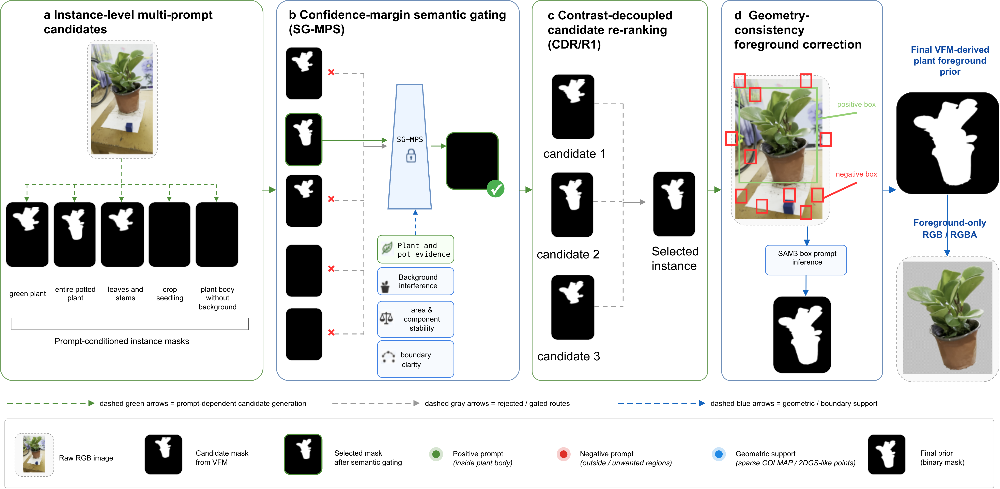
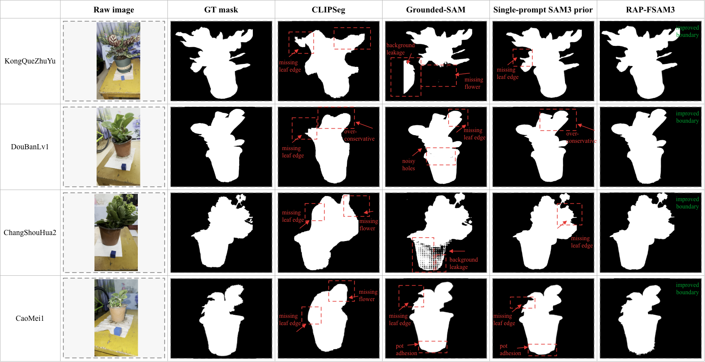
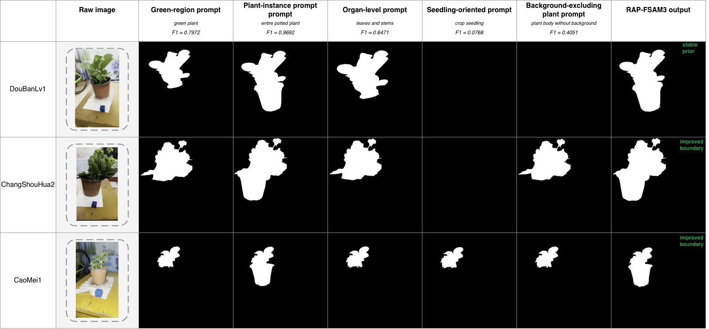

<!--
编辑正文、标题、摘要、关键词和图注时请直接修改本文件。
作者和单位保存在 ForeSplat-pandoc.template.tex 中。
保留图表和章节的标签、[@ref...] 引用键以及 {=latex} 围栏。
在本目录运行以下命令，导出到新文件（不覆盖原稿）：
pandoc ForeSplat.md -f markdown -t latex --standalone --natbib --wrap=none --template=ForeSplat-pandoc.template.tex -o ForeSplat-from-md.tex
-->

# Science4Impact Statement {#science4impact-statement .unnumbered .unlisted}

ForeSplat converts multiview RGB images into centimetre-scale meshes of potted plants and exports separately inspectable leaf surfaces. The workflow keeps the link between each exported leaf and its supporting images, making it possible to check where a trait estimate comes from and to flag leaves with incompletely observed margins.

# Introduction {#sec:introduction}

Plant phenotyping provides a technical bridge between genotype, environmental response and agronomic performance. Field high-throughput phenotyping has long been recognised as a bottleneck in translating genomic advances into measurable breeding progress [@ref1; @ref2]. Structural traits such as plant height, canopy width, leaf length and leaf width are widely used in breeding selection, cultivation management and growth assessment [@ref6; @ref56; @ref61]. Manual measurement is labour-intensive, low-throughput and sensitive to operator experience, whereas two-dimensional imaging cannot fully represent overlapping leaves, occluded organs and non-planar canopy geometry. Crop phenomics therefore calls for coordinated trait acquisition, data management and interpretation rather than imaging alone [@ref3]. Recent low-cost phenotyping systems likewise emphasise the need for accessible, scalable measurement pipelines [@ref62; @ref63]. High-throughput measurements can also help characterise diverse crop genetic resources at stages where conventional trait assessment is costly [@ref5]. Three-dimensional representations are therefore increasingly used to quantify plant structure, organ position and canopy morphology [@ref8; @ref10]. Recent reviews further show that 3D imaging and reconstruction are becoming central to trait detection and high-throughput phenotyping workflows [@ref9; @ref11; @ref12]. In practical potted-plant and controlled-environment settings, however, low-cost 3D phenotyping remains difficult because thin leaves, weak texture, repeated patterns, local occlusion, mixed flower--leaf structures and backgrounds with similar colours all reduce the robustness of reconstruction and measurement.

Three-dimensional plant phenotyping has expanded from structure from motion, multiview stereo and depth sensing to neural rendering and explicit Gaussian representations. Earlier reviews of plant imaging delineated the complementary roles of visible-light, spectral, thermal and 3D sensing for extracting different traits [@ref4]. The value of geometry-based phenotyping lies in relating explicit 3D structure to measurable whole-plant and organ traits [@ref7]. LiDAR and depth-sensing systems can provide accurate point clouds, but their cost, calibration complexity and deployment requirements limit broad use in horticultural facilities and breeding trials [@ref14]. Structured-light reconstruction and time-of-flight imaging have likewise been explored for plant acquisition, including the reconstruction of maize plants [@ref13; @ref15]. Consumer RGB cameras are flexible and inexpensive, but SfM/MVS remains sensitive to view coverage, image sharpness and leaf texture, even as recent low-cost multiview pipelines show that RGB reconstruction can support crop spatial-geometry analysis beyond single-sample measurement [@ref18; @ref19]. Classical dense multiview stereo combines photometric agreement with cross-view visibility constraints to reconstruct scene surfaces from overlapping images [@ref17]. NeRF improves visual reconstruction through continuous radiance fields and compact neural encodings [@ref20; @ref21; @ref22]. Modular research frameworks such as Nerfstudio have also facilitated the development and evaluation of NeRF-based pipelines [@ref23]. Recent plant studies have used NeRF for field and indoor plant geometry assessment [@ref25; @ref26]. An evaluation across increasingly challenging plant scenes, including field conditions, further documented the trade-off between geometric fidelity and reconstruction efficiency [@ref24]. Comparative plant NeRF studies further indicate that neural rendering can support low-cost crop reconstruction under practical acquisition settings [@ref59]. 3D Gaussian Splatting (3DGS) and 2D Gaussian Splatting (2DGS) further provide explicit and editable scene representations [@ref27; @ref28]. Efficient Gaussian variants also explore compression and compact scene representation [@ref51; @ref52; @ref53]. Mini-splatting shows that constrained Gaussian counts can further reduce representation size [@ref54]. Plant3R and PlantGaussian show that Gaussian representations can support plant-structure reconstruction and visualisation [@ref30; @ref31]. Cotton3DGaussians and object-centric 3DGS further extend this route to boll mapping, plant architecture analysis and strawberry phenotyping [@ref32; @ref33]. These advances also leave a practical agricultural question unresolved: is the reconstructed 3D object the plant object that needs to be measured?

A Gaussian representation fitted to multiview RGB images can reproduce appearance without uniquely defining the geometry needed for phenotyping. In potted plants, measurements depend on three additional requirements: a consistent physical scale, separation of the plant from its container, and association of each observed leaf across views. Thin margins and overlapping leaves make the last two requirements particularly difficult. Here, the potted-plant foreground is used as an initial image-space region of interest.

Vision foundation models provide promptable segmentation priors for plant phenotyping [@ref55], but individual prompts can include background vegetation, omit mature structures or truncate leaf margins. RAP-FSAM3 adapts these predictions to the potted-plant foreground task. We use the resulting foreground envelope to screen rendered depth observations, and use separate semantic and instance predictions to label visible mesh surfaces.

We present ForeSplat, a multiview RGB workflow that links calibrated surface reconstruction to plant and leaf measurements. Its contributions are: (1) RAP-FSAM3, which adapts promptable foreground segmentation to potted plants through semantic-gated candidate selection and structure-balanced refinement; (2) a metric Gaussian-to-mesh workflow that combines COLMAP, native GGGS, cube-based scale recovery and TSDF fusion; and (3) a multiview mesh-labelling procedure that separates plant and pot surfaces and exports individual leaf meshes with links to their supporting images.

# Materials and Methods {#sec:materials-and-methods}

## Study Design and Overall Workflow {#sec:study-design-and-overall-workflow}

COLMAP estimates camera poses and a sparse point cloud from multiview RGB images. After registration and before GGGS training, the potted-plant foreground masks are aligned with the corresponding undistorted views. Native GGGS is fitted using unmasked RGB images and the COLMAP sparse points. After scale recovery, the aligned masks screen the rendered GGGS depth before TSDF fusion. Separate SAM3 predictions support reference-cube detection, plant–pot separation and multiview leaf association. Whole-plant and leaf traits are computed from the corresponding centimetre-scale surfaces. The workflow is summarised in Fig. `\ref{fig:workflow}`{=latex}.

**[TODO: Fig. 1. Replace with the new COLMAP, mask alignment, GGGS and TSDF workflow.]**

```{=latex}
\begin{figure}[pos=!htbp]
\centering
\fbox{\rule{0pt}{2cm}\parbox{.8\linewidth}{\centering Draft placeholder: Figure 1}}
\caption{Overview of ForeSplat. The foreground masks are aligned to undistorted COLMAP views before GGGS training and applied to the rendered depth before metric TSDF fusion. GGGS is trained on unmasked RGB images with COLMAP sparse-point initialisation. Mesh labelling separates the plant from the pot and associates leaves across views for trait extraction.}\label{fig:workflow}
\end{figure}
```

```{=latex}
\FloatBarrier
```

## Datasets and Evaluation Protocols {#sec:dataset-acquisition-settings-and-sample}

We used three experimental protocols (Table `\ref{tab:dataset-protocol}`{=latex}). The foreground-prior evaluation used manually annotated frames from 21 multiview RGB sequences. For backend selection, we tested five Gaussian configurations on one development plant (KongQueZhuYu) using a common COLMAP reconstruction, 183 training views and 27 held-out views. The multi-plant workflow covered 19 potted plants spanning nine recorded plant types: four development plants and 15 held out from workflow development (Table `\ref{tab:dataset-coverage}`{=latex}). The single-plant comparison is part of development, not an independent multi-plant benchmark.

```{=latex}
\begin{table}[pos=!htbp]
\caption{Datasets and evaluation protocols for the ForeSplat study.}\label{tab:dataset-protocol}
\centering\small\setlength{\tabcolsep}{4pt}
\resizebox{\linewidth}{!}{%
\begin{tabular}{@{}lll@{}}
\toprule
Protocol & Evaluation units & Purpose \\
\midrule
Foreground-prior evaluation & Annotated frames from 21 RGB sequences & VFM comparison, prompt sensitivity and RAP-FSAM3 ablation \\
Single-plant backend selection & 1 plant; 183 training views and 27 held-out views & Comparison of Gaussian configurations and mesh extraction \\
Multi-plant reconstruction & 19 plants across 9 recorded plant types & Metric calibration, reconstruction and leaf instance extraction \\
Manual-reference comparison & 57 identity-matched leaves; valid pairs pending by trait & Plant height, canopy width, leaf length and leaf width \\
\bottomrule
\end{tabular}}
\end{table}
```

```{=latex}
\begin{table}[pos=!htbp]
\caption{Plant types recorded in the 19-plant reconstruction dataset. These labels are dataset identifiers.}\label{tab:dataset-coverage}
\centering\small\setlength{\tabcolsep}{4pt}
\resizebox{\linewidth}{!}{%
\begin{tabular}{@{}lrrr@{}}
\toprule
Recorded plant type & Total & Development & Held-out workflow assessment \\
\midrule
CaoMei & 2 & 0 & 2 \\
ChangShouHua & 3 & 1 & 2 \\
DouBanLv & 3 & 0 & 3 \\
HongZhang & 1 & 0 & 1 \\
KongQueZhuYu & 1 & 1 & 0 \\
WanNianQing & 2 & 0 & 2 \\
WangWenCao & 2 & 1 & 1 \\
XianKeLai & 3 & 0 & 3 \\
XiangPiShu & 2 & 1 & 1 \\
Total & 19 & 4 & 15 \\
\bottomrule
\end{tabular}}
\end{table}
```

```{=latex}
\FloatBarrier
```

## RAP-FSAM3: Reconstruction-Aware Prompt-Adaptive Foreground Priors {#sec:rap-fsam3}

RAP-FSAM3 is designed to generate potted-plant foreground priors for 3D reconstruction rather than to serve as an independent general segmentation model. Its input is the raw multiview RGB frames of each plant.

RAP-FSAM3 produces a binary mask, an alpha image and a foreground RGB image aligned to each processed RGB frame. The binary mask supplies the potted-plant depth-screening envelope where an archived mask is available; missing envelopes are replaced by direct SAM3 potted-plant predictions. The masked RGB images are not used for GGGS photometric optimisation.

RAP-FSAM3 first removes severely blurred frames through frequency-domain quality filtering and then adapts VFM masks to the reconstruction task through multi-prompt candidate generation, semantic-gated selection and foreground--background prompt refinement.

### FFT-Based Frame-Quality Filtering {#sec:fft-based-frame-quality-filtering}

Blurred, defocused and weakly textured frames can affect SfM pose estimation, VFM mask boundaries and downstream surface reconstruction. Comparative studies of focus-measure operators show that their responses depend on image properties and acquisition conditions, motivating an adaptive quality criterion [@ref50]. We computed the two-dimensional FFT magnitude spectrum for each frame and used a normalised high-frequency saliency index rather than an absolute high-frequency sum:

$$Q_{\text{FFT}}(I)=
\frac{\left\| W_H\odot \log\left(1+\left|\mathcal{F}(I)\right|\right)\right\|_1}
{\left\| \log\left(1+\left|\mathcal{F}(I)\right|\right)\right\|_1+\varepsilon} .$$

Here, $I$ denotes the input frame after conversion to grayscale for quality evaluation, and $\mathcal{F}(I)$ denotes its two-dimensional Fourier transform. The term $|\mathcal{F}(I)|$ is the magnitude spectrum, and $\log(1+|\mathcal{F}(I)|)$ compresses the dynamic range of the spectrum so that a few extremely strong low-frequency components do not dominate the score. $W_H\in[0,1]^{H\times W}$ is a radial high-pass weighting mask, where entries close to the spectral centre receive low weights and high-frequency regions receive large weights. The operator $\odot$ denotes element-wise multiplication, $\|\cdot\|_1$ sums the weighted spectral responses, and $\varepsilon$ is a small constant used to avoid division by zero. Therefore, $Q_{\text{FFT}}(I)$ is a normalised high-frequency saliency score: a larger value indicates that the frame contains richer edges and details and is less likely to be severely blurred. The distribution of $Q_{\text{FFT}}$ was computed independently for each sequence, and the first quartile was used as a sample-adaptive threshold. Frames below this threshold were excluded from subsequent segmentation and COLMAP processing.

### Multi-Prompt VFM Candidate Generation {#sec:multi-prompt-vfm-candidates}

Frames that passed quality filtering were input to the VFM. Promptable segmentation models have shown strong general foreground localisation in natural-image and video segmentation [@ref38; @ref39; @ref71]. Plant point-cloud segmentation studies indicate that learned 3D segmentation can support organ-level structural analysis [@ref42; @ref43]. Earlier work on plant-part segmentation also showed that integrating information from multiple views can improve organ-level interpretation relative to isolated two-dimensional predictions [@ref41]. Recent open-vocabulary methods have broadened prompt-based object perception for complex scenes [@ref40; @ref64]. Point Transformer V3 further strengthens general-purpose 3D representation learning [@ref44]. For each frame $I_i$, RAP-FSAM3 queries the VFM using five plant-related prompts: a green-region prompt, `green plant`; a plant-instance prompt, `entire potted plant`; an organ-level prompt, `leaves and stems`; a seedling-oriented prompt, `crop seedling`; and a background-excluding plant prompt, `plant body without background`. For frame $I_i$ and prompt $P_k$, let the instance-wise candidate set returned by the VFM be

$$\mathcal{C}_i^{(k)}=\left\{c_{i,j}^{(k)}\right\}_{j=1}^{N_{i,k}},\qquad k\in\{1,\ldots,5\},$$

and let the frame's full candidate pool be

$$\mathcal{C}_i=\bigcup_{k=1}^{5}\mathcal{C}_i^{(k)}.$$

Here, $i$ is the frame index, $k$ is the prompt index, $N_{i,k}$ is the number of instance candidates returned by prompt $P_k$ for frame $i$, and $c_{i,j}^{(k)}$ denotes the $j$-th candidate produced by the $k$-th prompt, which includes at minimum its binary mask $M_{i,j}^{(k)}\in\{0,1\}^{H\times W}$, source prompt identifier, and candidate confidence information from the segmentation model. This set-based formulation makes explicit that each prompt may return multiple instance candidates in instance-wise mode, rather than the simplified representation where each prompt corresponds to a single mask. The plant-instance prompt is defined as a potted-plant foreground prompt rather than a strict plant-body-only prompt, because in the collected scenes the VFM often treats the plant and its visible supporting container as one coherent foreground instance. This design allows the method to expose and handle prompt-induced semantic bias instead of relying on a single fixed textual description.

### Semantic-Gated Multi-Prompt Selection {#sec:semantic-gated-selection}

A naive prompt selector that considers only mask geometry may choose a semantically inappropriate candidate, such as an organ-only or seedling-oriented mask in a mature potted plant. RAP-FSAM3 therefore uses semantic-gated multi-prompt selection. For each candidate mask, we construct a foreground-prior descriptor

$$\boldsymbol{\phi}_i^{(k)}=\left[
q_{\text{plant}},\ q_{\text{pot}},\ q_{\text{area}},\ q_{\text{comp}},\ q_{\text{edge}},\ q_{\text{contrast}},\ q_{\text{temp}}
\right]^{\top},$$

and an interference descriptor

$$\boldsymbol{\psi}_i^{(k)}=\left[
q_{\text{table}},\ q_{\text{bg}},\ q_{\text{neighbour}},\ q_{\text{outlier}}
\right]^{\top}.$$

The semantic compatibility of the $k$-th candidate is modelled as a gated confidence score

$$s_i^{(k)}=\mathbf{w}_{\phi}^{\top}\boldsymbol{\phi}_i^{(k)}
-\mathbf{w}_{\psi}^{\top}\boldsymbol{\psi}_i^{(k)}-b,
\qquad c_i^{(k)}=\sigma\!\left(s_i^{(k)}\right),$$

In these equations, $\boldsymbol{\phi}_i^{(k)}$ describes the foreground reliability of the $k$-th candidate in frame $i$. Specifically, $q_{\text{plant}}$ measures plant-body semantic evidence via reference recall against plant reference regions, $q_{\text{pot}}$ measures consistency with the complete potted-plant target definition when a visible supporting container is present, $q_{\text{area}}$ measures whether the foreground area lies in a reasonable range, $q_{\text{comp}}$ penalises fragmented connected components, $q_{\text{edge}}$ measures boundary clarity, $q_{\text{contrast}}$ measures foreground-background appearance separability, and $q_{\text{temp}}$ measures temporal consistency with neighbouring frames. The vector $\boldsymbol{\psi}_i^{(k)}$ describes external interference evidence, where $q_{\text{table}}$, $q_{\text{bg}}$, $q_{\text{neighbour}}$ and $q_{\text{outlier}}$ measure the degree to which the candidate leaks into table regions, distant background regions, neighbouring plants and isolated outlier fragments. In the current implementation, pot evidence is treated as positive cue with weight $w_{\text{pot}}=0.2$. Plant reference evidence adopts a reference-recall formulation; the green reference component is selected from green connected components as the component whose union with the candidate mask has the largest overlap. Because this work defines the complete potted plant as the target object, the visible container is not treated as a background negative class. Container regions are anchored based on plant-base detection. $\mathbf{w}_{\phi}$ and $\mathbf{w}_{\psi}$ are weighting vectors for foreground reliability and interference evidence, $b$ is a bias term, and $\sigma(\cdot)$ is the sigmoid function that maps the semantic compatibility score to $[0,1]$. Thus, $c_i^{(k)}$ represents the semantic compatibility of the $k$-th candidate. Candidate reliability is then normalised through a temperature-controlled softmax,

$$a_i^{(k)}=\frac{\exp\left(c_i^{(k)}/\tau\right)}
{\sum_{l=1}^{5}\exp\left(c_i^{(l)}/\tau\right)},\qquad k=1,\ldots,5.$$

where $a_i^{(k)}$ is the normalised reliability assigned to the $k$-th candidate and $\tau=0.25$ is the softmax temperature controlling how sharply the method selects among prompts. A smaller $\tau$ makes the selection closer to a hard argmax, whereas a larger value makes the reliability distribution smoother. Let $a_{i,(1)}$ and $a_{i,(2)}$ denote the highest and second-highest confidence scores after sorting, and define the confidence gap $\Delta_i=a_{i,(1)}-a_{i,(2)}$. SG-MPS uses a selective decision rule with threshold $\delta=0.05$:

$$g_i=\begin{cases}
P_{(1)}, & \Delta_i\geq\delta,\\
\varnothing, & \Delta_i<\delta,
\end{cases}
\qquad \delta=0.05.$$

When $\Delta_i\geq 0.05$, SG-MPS outputs the prompt $P_{(1)}$ corresponding to the highest confidence; when $\Delta_i<0.05$, the module outputs an empty decision $\varnothing$, meaning it does not independently determine the prompt based on gating scores but instead delegates the candidate instance decision to the subsequent CDR/R1 ranking step. This mechanism allows the model to selectively abstain when prompt semantic advantage is insufficient, rather than forcing a unique prompt output for every frame.

### Contrast-Decoupled Re-ranking {#sec:contrast-decoupled-reranking}

After SG-MPS completes semantic evaluation of candidates, RAP-FSAM3 uses a contrast-decoupled re-ranking strategy (CDR) to rank candidate instances. The goal of CDR is to reduce the dependence of candidate ranking on foreground--background appearance contrast, making target selection rely more on structure and semantic evidence relevant to the potted-plant instance. This module does not change the pixel boundaries of candidate masks; instead, it changes the relative ordering of candidates and outputs a target candidate for use by SB-FBPR.

Let the prompt-level gating state output by SG-MPS be $g_i$, and the candidate pool be $\mathcal{C}_i$. The CDR/R1 selection process can be expressed as

$$c_i^{\star}=\underset{c\in\mathcal{C}_i}{\operatorname{arg\,max}}\;S_{\mathrm{R1}}(c\mid g_i),
\qquad M_i^{\mathrm{cand}}=\operatorname{Mask}(c_i^{\star}),$$

where $S_{\mathrm{R1}}(c\mid g_i)$ denotes the R1 candidate ranking score computed under the SG-MPS gating state; when $g_i$ is a high-confidence prompt, that prompt information participates in candidate instance ranking; when $g_i=\varnothing$, R1 determines the target instance based on candidate ranking scores. $c_i^{\star}$ is the selected candidate instance, and $M_i^{\mathrm{cand}}$ is its initial mask.

### Structure-Balanced Foreground--Background Prompt Refinement {#sec:foreground-background-refinement}

After CDR/R1 determines the target candidate, structure-balanced foreground--background prompt refinement (SB-FBPR) constructs positive and negative bounding-box prompts based on the target candidate and uses SAM3 for a second segmentation inference. The current method uses one positive bounding box to locate the target potted-plant instance and eight negative bounding boxes to represent interference regions around the target; the negative prompt regions are constructed through a ring strategy around the target boundary, providing spatially constrained background prompts outside the foreground boundary. Let the target candidate mask be $M_i^{\mathrm{cand}}$ and the dilation radius be $r$. The ring-style negative prompt region can be conceptually expressed as

$$\mathcal{R}_i^{-}=\operatorname{Dilate}(M_i^{\mathrm{cand}},r)\setminus M_i^{\mathrm{cand}}.$$

Within this region, eight negative bounding boxes $\mathcal{B}_i^{-}=\{B_{i,1}^{-},\ldots,B_{i,8}^{-}\}$ are constructed, and one positive bounding box $B_i^{+}$ represents the target candidate. The second segmentation process of SAM3 can be expressed as

$$M_i^{\mathrm{final}}=\operatorname{SAM3}\!\left(I_i,B_i^{+},\mathcal{B}_i^{-}\right),$$

where $I_i$ is the input image, $B_i^{+}$ is the positive target box, $\mathcal{B}_i^{-}$ is the set of eight negative bounding boxes, and $M_i^{\mathrm{final}}$ is the final foreground mask. This step converts candidate instance selection into a re-segmentation process with target and interference spatial prompts. The complete RAP-FSAM3 foreground-prior generation process is summarised in Fig. `\ref{fig:rap-fsam3}`{=latex}.

```{=latex}
\begin{center}
\begin{minipage}{\textwidth}
\noindent\textbf{Algorithm 1: RAP-FSAM3 foreground candidate selection and prompt-guided segmentation.}\par\smallskip
\footnotesize
\setlength{\tabcolsep}{4pt}
\begin{tabularx}{\textwidth}{@{}rX@{}}
\multicolumn{2}{@{}l}{\textbf{Input:} image $I_i$; prompts $\mathcal{P}=\{P_1,\ldots,P_5\}$; frozen SAM3; $\tau=0.25$; $\delta=0.05$} \\
\multicolumn{2}{@{}l}{\textbf{Output:} final foreground mask $M_i^{\mathrm{final}}$} \\
1 & $\mathcal{C}_i\gets\varnothing$ \\
2 & \textbf{for} each prompt $P_k\in\mathcal{P}$ \textbf{do} \\
3 & \quad $\mathcal{C}_i^{(k)}\gets\operatorname{SAM3}(I_i,P_k;\,\text{instance-wise mode})$ \\
4 & \quad $\mathcal{C}_i\gets\mathcal{C}_i\cup\mathcal{C}_i^{(k)}$ \\
5 & \textbf{end for} \\
6 & Compute semantic confidence $c_i^{(k)}$ for $P_1$--$P_5$ and softmax weight $a_i^{(k)}$ using $\tau$ \\
7 & $\Delta_i\gets a_{i,(1)}-a_{i,(2)}$ \\
8 & \textbf{if} $\Delta_i\geq\delta$ \textbf{then} \\
9 & \quad $g_i\gets P_{(1)}$ (selective semantic-gating output) \\
10 & \textbf{else} \\
11 & \quad $g_i\gets\varnothing$ (selective abstention) \\
12 & \textbf{end if} \\
13 & $c_i^{\star}\gets\underset{c\in\mathcal{C}_i}{\operatorname{arg\,max}}\,S_{\mathrm{R1}}(c\mid g_i)$ \\
14 & $M_i^{\mathrm{cand}}\gets\operatorname{Mask}(c_i^{\star})$ \\
15 & Construct one positive box $B_i^+$ and eight negative boxes $\mathcal{B}_i^-$ using the ring strategy \\
16 & $M_i^{\mathrm{final}}\gets\operatorname{SAM3}(I_i,B_i^+,\mathcal{B}_i^-)$ \\
17 & \textbf{return} $M_i^{\mathrm{final}}$ \\
\end{tabularx}
\end{minipage}
\end{center}
```

{#fig:rap-fsam3 width="100%" height="46%"}

```{=latex}
\FloatBarrier
```

## COLMAP and Geometry-Grounded Gaussian Splatting {#sec:colmap-gggs}

Camera intrinsics, poses and sparse points were obtained from COLMAP structure from motion [@ref16]. After COLMAP registration and before GGGS training, we mapped the potted-plant foreground masks to the image coordinates of the corresponding undistorted RGB views and stored them separately. The masks were later used to screen GGGS-rendered depth before TSDF fusion.

Native GGGS (Zhang et al., *Grounding Gaussian Splatting Geometry with Stochastic Solids*) was trained on the undistorted RGB images without masking and initialised with the COLMAP sparse points without foreground filtering. The run used 30,000 iterations, spherical harmonic degree 3, spherical Gaussian degree 0 and seed 0. The native photometric, depth–normal and multiview regularisation terms were retained. For meshing, we use the median camera-axis depth returned by the GGGS renderer.

<!-- TODO: Add the verified Zhang et al. GGGS BibTeX entry to cas-refs.bib and cite it here. -->

## Metric Scale Recovery {#sec:metric-scale-recovery}

A blue reference cube with a known edge length of 2 cm provides the scale. We fit the projections of a common three-dimensional cube to silhouettes in registered views. If the fitted edge length is $l_c$ in reconstruction units, the conversion is $s = 2\,\mathrm{cm}/l_c$. We multiply Gaussian centres, length-valued filter parameters and camera translations by $s$, and add $\log s$ to the stored Gaussian log-scales. Camera rotations and intrinsics remain unchanged. Metric mesh coordinates are subsequently used directly for trait extraction.

Of the 19 specimens, 18 were calibrated from automatically segmented SAM3 cube silhouettes (3 development and 15 held-out specimens). For the remaining development specimen (KongQueZhuYu), we reused a cube fit based on manually annotated silhouettes from five registered views. For each automatic fit, we sampled 24 candidate views and discarded views with an initial silhouette-support root mean square (RMS) residual of 2 pixels or more when a strict majority remained. The final fits used 16–22 views per specimen in the automatic group (344 of 432 candidate views in total). All 19 specimens passed calibration, with a final silhouette-support RMS residual below 2 pixels and at least four independently triangulated corners and three adjacent edges per specimen. No specimen was excluded from metric reconstruction on calibration grounds.

## TSDF-Based Mesh Reconstruction {#sec:tsdf-mesh-reconstruction}

From each registered camera we render GGGS median depth and alpha. A depth is eligible for fusion only if it is finite, positive, has alpha at least 0.5 and lies within the potted-plant foreground mask. Only training views are integrated. Voxel length is set to $D_{\mathrm{scene}}/512$, where $D_{\mathrm{scene}}$ is the diagonal of the robust scene bounding box derived from the 0.5th and 99.5th percentiles along each coordinate axis. The TSDF truncation distance is five voxel lengths. We use standard bounded TSDF integration [@ref45] and extract a triangle mesh with Marching Cubes [@ref46]; post-processing removes connected components with fewer than 50 triangles, without smoothing or filling holes. We reuse the bounded TSDF implementation from the 2DGS software [@ref28], but the inputs to fusion are rendered by GGGS (Fig. `\ref{fig:metric-tsdf}`{=latex}).

## Plant-Only Mesh and Multiview Leaf Association {#sec:plant-leaf-instances}

We assign semantic labels to the mesh by projecting SAM3 plant and pot masks through the registered cameras. Votes are restricted to the first intersected surface along each ray and screened for consistency with GGGS depth. A triangle needs at least three view votes and a class vote share of at least 0.6 to receive a semantic label; unsupported or inconsistent triangles are retained as unknown rather than reassigned to the plant. The plant-only mesh consists of plant-labelled faces.

SAM3 leaf proposals from different views are associated through their shared support on visible plant triangles. A candidate instance must be supported by at least three views. A plant triangle is assigned to an instance if at least two distinct views support the assignment and the instance receives at least 0.6 of that triangle's leaf votes. The assigned faces are exported as a centimetre-scale leaf mesh with a `Leaf ID`, a reference image and source-face indices. The association procedure is illustrated in Fig. `\ref{fig:leaf-association}`{=latex}.

## Phenotypic Trait Extraction {#sec:phenotypic-traits}

Plant height is estimated as the maximum projection of the plant-only mesh above the estimated base along the estimated vertical axis. Canopy width is the maximum span of the horizontally projected plant surface. Leaf length is measured as the three-dimensional Euclidean distance between the identified leaf base and tip on the mesh. Leaf width is the maximum accepted transverse path across the observed surface. Uncertain landmarks, incomplete surfaces and rejected transverse paths are flagged.

## Evaluation Metrics {#sec:evaluation-metrics}

The foreground-prior evaluation retains the original F1, mIoU, HD95, Boundary-F1 and leakage-energy metrics. In the single-plant development experiment, held-out rendering quality and geometric proxies are reported separately; projected silhouette agreement and agreement with the renderer's depth are not equivalent to accuracy against a reference 3D scan. Trait agreement is assessed using references from the same specimen and capture session and, for leaf traits, the same leaf. The planned statistics are the eligible pair count, MAE, RMSE and signed bias for each trait. Bias is defined as the mesh-derived value minus the manual reference. Manual leaf measurements were recorded in centimetres. On each matched leaf, leaf length was measured as the three-dimensional Euclidean distance from the leaf base to the tip. Leaf width was measured as the three-dimensional Euclidean distance between the two opposing leaf margins at the selected transverse position. For comparison with these references, the mesh measurements must use the corresponding landmarks and the same straight-line distances.

# Results {#sec:results}

## RAP-FSAM3 Improves VFM-Based Plant Foreground Priors {#sec:vfm-baseline-results}

We first compared RAP-FSAM3 with representative automatic VFM-based foreground extraction methods on manually annotated evaluation frames sampled from all 21 RGB sequences. RAP-FSAM3 achieved F1 = 0.9706, mIoU = 0.9641, HD95 = 183.42 px, Boundary-F1 = 0.4643 and leakage energy = 0.001739. Compared with single-prompt SAM3 [@ref71], the improvement was most evident in boundary consistency and leakage suppression rather than in region-overlap metrics alone. The quantitative comparison is summarised in Table `\ref{tab:vfm-comparison}`{=latex}, and representative visual comparisons are shown in Fig. `\ref{fig:vfm-comparison}`{=latex}. A complete nine-method comparison, including SEEM, Grounded-SAM2, SAM2 oracle, U-Net and DeepLabv3+ lite, is provided in the supplementary material. SAM2 oracle is treated as an interaction-assisted upper-bound reference rather than a directly comparable automatic method.

```{=latex}
\begin{table}[pos=!htbp]
\caption{Core automatic VFM foreground-prior comparison on manually annotated evaluation frames sampled from all 21 RGB sequences. Single-prompt SAM3 uses the same frozen SAM3 backbone as RAP-FSAM3 but without prompt adaptation or refinement.}\label{tab:vfm-comparison}
\centering
\scriptsize
\setlength{\tabcolsep}{4pt}
\resizebox{\textwidth}{!}{%
\begin{tabular}{@{}lccccc@{}}
\toprule
Method & F1 $\uparrow$ & mIoU $\uparrow$ & HD95 / px $\downarrow$ & Boundary-F1 $\uparrow$ & Leakage energy $\downarrow$ \\
\midrule
CLIPSeg & 0.9221 & 0.9076 & 310.37 & 0.0874 & 0.018218 \\
Grounded-SAM & 0.9443 & 0.9335 & 246.36 & 0.4034 & 0.004374 \\
Single-prompt SAM3 prior & 0.9692 & 0.9624 & 193.71 & 0.4051 & 0.002272 \\
RAP-FSAM3 & \textbf{0.9706} & \textbf{0.9641} & \textbf{183.42} & \textbf{0.4643} & \textbf{0.001739} \\
\bottomrule
\end{tabular}%
}
\end{table}
```

{#fig:vfm-comparison width="100%" height="46%"}

```{=latex}
\FloatBarrier
```

## Prompt Sensitivity Reveals Semantic Bias in Direct VFM Prompting {#sec:prompt-robustness-results}

We then evaluated the stability of direct VFM prompting. The plant-instance prompt was the most stable direct prompt, with F1 = 0.9692 on the same manually annotated evaluation frames. Its masks often retained the visible pot together with the plant, indicating that the VFM interpreted the target as a complete potted-plant foreground instance rather than a plant-body-only object. The green-region prompt reached F1 = 0.7972 but was prone to including green background regions. In contrast, the organ-level prompt showed under-recall, the seedling-oriented prompt failed systematically on mature or mixed-structure plants, and the background-excluding plant prompt was overly conservative. These results show that single-prompt VFM segmentation is semantically fragile in potted-plant scenes. The prompt robustness results are summarised in Table `\ref{tab:prompt-robustness}`{=latex}, and representative prompt failure modes are shown in Fig. `\ref{fig:prompt-failure}`{=latex}.

```{=latex}
\begin{table}[pos=!htbp]
\caption{Prompt robustness of direct VFM foreground extraction on the same manually annotated evaluation frames.}\label{tab:prompt-robustness}
\centering
\scriptsize
\setlength{\tabcolsep}{4pt}
\resizebox{\textwidth}{!}{%
\begin{tabular}{@{}llll@{}}
\toprule
Prompt type & Text prompt & F1 $\uparrow$ & Main behaviour \\
\midrule
Green-region prompt & \texttt{green plant} & 0.7972 & Prone to green-background inclusion \\
Plant-instance prompt & \texttt{entire potted plant} & 0.9692 & Most stable foreground-instance prompt; includes visible pot support \\
Organ-level prompt & \texttt{leaves and stems} & 0.6471 & Under-recall for mixed or thick structures \\
Seedling-oriented prompt & \texttt{crop seedling} & 0.0768 & Near-empty masks on mature plants \\
Background-excluding plant prompt & \texttt{plant body without background} & 0.4051 & Over-conservative foreground extraction \\
\bottomrule
\end{tabular}%
}
\end{table}
```

{#fig:prompt-failure width="100%" height="46%"}

```{=latex}
\FloatBarrier
```

## Ablation of RAP-FSAM3 Adaptation Modules {#sec:rap-ablation-results}

We further evaluated the RAP-FSAM3 adaptation components on the same manually annotated evaluation frames. The fixed plant-instance prompt served as the direct single-prompt baseline and corresponds to the Single-prompt SAM3 prior in Table `\ref{tab:vfm-comparison}`{=latex}. To test whether multi-prompt selection was reliable by itself, we included a diagnostic geometry-only multi-prompt selector without semantic gating. This variant selected semantically inappropriate candidates in several frames and degraded F1, mIoU, HD95 and Boundary-F1, even though leakage energy alone did not fully reflect the missing-foreground failure. After semantic gating was introduced, the selected prior recovered the stable plant-instance prompt under this evaluation protocol, producing the same evaluated masks as the fixed prompt while avoiding the geometry-only failure mode. Structure-balanced foreground--background refinement improved boundary quality and leakage suppression, and the complete RAP-FSAM3 achieved the best overall metrics, matching the final RAP-FSAM3 result reported in Table `\ref{tab:vfm-comparison}`{=latex}. The module ablation is shown in Table `\ref{tab:rap-ablation}`{=latex}.

```{=latex}
\begin{table}[pos=!htbp]
\caption{Ablation of RAP-FSAM3 adaptation components on the same manually annotated evaluation frames. The geometry-only selector is a diagnostic variant used to evaluate the necessity of semantic-gated multi-prompt selection. The fixed plant-instance prompt and the full RAP-FSAM3 correspond to the shared baseline and final method in Table~\ref{tab:vfm-comparison}.}\label{tab:rap-ablation}
\centering
\scriptsize
\setlength{\tabcolsep}{3pt}
\resizebox{\textwidth}{!}{%
\begin{tabular}{@{}lccccccc@{}}
\toprule
Setting & SG-MPS & SB-FBPR & F1 $\uparrow$ & mIoU $\uparrow$ & HD95 / px $\downarrow$ & Boundary-F1 $\uparrow$ & Leakage energy $\downarrow$ \\
\midrule
Fixed plant-instance prompt & -- & -- & 0.9692 & 0.9624 & 193.71 & 0.4051 & 0.002272 \\
Geometry-only multi-prompt selector w/o SG-MPS & No & -- & 0.8429 & 0.8533 & 1008.90 & 0.3214 & 0.002035 \\
Semantic-gated selected prior & Yes & -- & 0.9692 & 0.9624 & 193.71 & 0.4051 & 0.002272 \\
RAP-FSAM3 (ours, full) & Yes & Yes & \textbf{0.9706} & \textbf{0.9641} & \textbf{183.42} & \textbf{0.4643} & \textbf{0.001739} \\
\bottomrule
\end{tabular}%
}
\begin{flushleft}
\scriptsize SG-MPS: semantic-gated multi-prompt selection; SB-FBPR: structure-balanced foreground--background prompt refinement.
\end{flushleft}
\end{table}
```

```{=latex}
\FloatBarrier
```

These results describe RAP-FSAM3 performance under the original 21-sequence foreground protocol.

## Single-Plant Backend Selection {#sec:backend-selection-results}

On the KongQueZhuYu development plant, MCMC-3DGS achieved higher foreground PSNR than GGGS on the 27 held-out views (25.42 versus 24.96 dB). GGGS nevertheless provided the strongest depth self-consistency in this comparison. In the subsequent mesh comparison, bounded TSDF using GGGS depth reached a silhouette IoU of 0.900, compared with 0.878 for 2DGS with bounded TSDF; 2DGS had slightly higher Boundary-F1 at a two-pixel tolerance. We selected GGGS with bounded TSDF for the multi-plant workflow on the basis of these geometric proxies, not because it delivered the highest image PSNR or established absolute surface accuracy. The Gaussian and mesh comparisons are reported separately in Table `\ref{tab:backend-selection}`{=latex}.

```{=latex}
\begin{table}[pos=!htbp]
\caption{Single-plant backend selection on KongQueZhuYu. Panel A compares five Gaussian training configurations; depth consistency is measured at a 2\% threshold. Panel B compares seven post-processed meshes on 27 held-out views. Silhouette IoU and boundary F1 use RAP-FSAM3 predictions as the reference. Neither panel measures accuracy against a 3D scan.}\label{tab:backend-selection}
\centering\small\setlength{\tabcolsep}{4pt}
\textbf{A. Gaussian training configurations}\par\smallskip
\resizebox{\linewidth}{!}{%
\begin{tabular}{@{}lrrr@{}}
\toprule
Configuration & Foreground PSNR (dB) & Depth self-consistency (\%) & Retained depth samples (\%) \\
\midrule
3DGS & 24.08 & 57.94 & 62.10 \\
2DGS & 23.91 & 87.69 & 79.82 \\
GGGS & 24.96 & 99.45 & 84.32 \\
gsplat (DefaultStrategy) & 22.63 & 45.85 & 61.32 \\
MCMC-3DGS & 25.42 & 84.52 & 75.73 \\
\bottomrule
\end{tabular}}
\par\medskip
\textbf{B. Mesh extraction configurations}\par\smallskip
\resizebox{\linewidth}{!}{%
\begin{tabular}{@{}llrrr@{}}
\toprule
Gaussian model & Extractor & Silhouette IoU & Outside-mask hit rate & Boundary F1 (2 px) \\
\midrule
GGGS & NKSR (chunked KS) & 0.60937 & 0.26014 & 0.12826 \\
GGGS & Bounded TSDF & 0.89965 & 0.04282 & 0.40837 \\
GGGS & Poisson (depth 10) & 0.30684 & 1.00000 & 0.08307 \\
GGGS & Native tetrahedra & 0.54637 & 0.35768 & 0.16095 \\
2DGS & NKSR (chunked KS) & 0.39394 & 0.67491 & 0.04026 \\
2DGS & Bounded TSDF & 0.87814 & 0.05380 & 0.41229 \\
2DGS & Poisson (depth 10) & 0.32308 & 0.93512 & 0.05998 \\
\bottomrule
\end{tabular}}
\end{table}
```

**[TODO: Fig. 5. Insert reference-cube projection, screened depth and metric mesh panels.]**

```{=latex}
\begin{figure}[pos=!htbp]
\centering
\fbox{\rule{0pt}{2cm}\parbox{.8\linewidth}{\centering Draft placeholder: Figure 5}}
\caption{Cube-based scale recovery and metric TSDF fusion.}\label{fig:metric-tsdf}
\end{figure}
```

**[TODO: Fig. 6. Insert RGB, SAM3 leaf masks, supported triangles and extracted leaf mesh panels.]**

```{=latex}
\begin{figure}[pos=!htbp]
\centering
\fbox{\rule{0pt}{2cm}\parbox{.8\linewidth}{\centering Draft placeholder: Figure 6}}
\caption{Multiview leaf association on the plant mesh.}\label{fig:leaf-association}
\end{figure}
```

**[TODO: Fig. 7. Insert matched-view comparisons from the new single-plant experiment.]**

```{=latex}
\begin{figure}[pos=!htbp]
\centering
\fbox{\rule{0pt}{2cm}\parbox{.8\linewidth}{\centering Draft placeholder: Figure 7}}
\caption{Single-plant Gaussian and mesh selection.}\label{fig:backend-selection}
\end{figure}
```

```{=latex}
\FloatBarrier
```

## Metric Reconstruction Across Potted Plants {#sec:workflow-validation-results}

The metric reconstruction workflow was applied to 19 potted plants spanning nine recorded plant types. Workflow completion, semantic separation and measurement accuracy are reported as distinct outcomes. Table `\ref{tab:reconstruction}`{=latex} summarises scale calibration, metric mesh completion and calibration quality control.

```{=latex}
\begin{table}[pos=!htbp]
\caption{Scale calibration and centimetre-scale mesh reconstruction across 19 potted plants.}\label{tab:reconstruction}
\centering\small\setlength{\tabcolsep}{4pt}
\begin{tabular}{@{}p{.25\linewidth}p{.70\linewidth}@{}}
\toprule
Outcome & Result \\
\midrule
Scale calibration & 19/19 specimens passed (development 4/4, held-out validation 15/15). \\
Metric bounded TSDF mesh & 19/19 calibrated specimens yielded a centimetre-scale mesh (19/19 of the full cohort, development 4/4 and held-out validation 15/15). \\
Calibration source & SAM3 automatically segmented multiview cube silhouettes for 18/19 specimens. For KongQueZhuYu, the cube fit used previously annotated silhouettes from five registered views. All specimens were included. \\
Scale factor & 4.758--13.031 cm per reconstruction unit (median 9.393). \\
Calibration quality control & Final silhouette-fit root mean square (RMS) residual: 0.568--1.305 px. All 19 fits passed the 2 px RMS threshold. The per-specimen mean corner reprojection error: 0.582--1.457 px. \\
\bottomrule
\end{tabular}
\end{table}
```

**[TODO: Fig. 8. Insert matched RGB images, Gaussian renderings, TSDF meshes and plant-only surfaces.]**

```{=latex}
\begin{figure}[pos=!htbp]
\centering
\fbox{\rule{0pt}{2cm}\parbox{.8\linewidth}{\centering Draft placeholder: Figure 8}}
\caption{Representative metric reconstructions across potted plants.}\label{fig:reconstruction}
\end{figure}
```

```{=latex}
\FloatBarrier
```

## Multiview Leaf Instances {#sec:leaf-instance-results}

Multiview association yielded 798 leaf-surface candidates across 19 plants. For comparison with manual measurements, we selected three leaves per plant (57 leaves in total) and verified the correspondence between each physical leaf and its reconstructed instance.

## Agreement with Manual Trait Measurements {#sec:trait-agreement-results}

[TODO: Add same-specimen manual references, the valid pair count, MAE, RMSE and signed bias for plant height, canopy width, leaf length and leaf width, and interpret the agreement. Update Table `\ref{tab:phenotyping}`{=latex} and Fig. `\ref{fig:phenotyping}`{=latex}.]

```{=latex}
\begin{table}[pos=!htbp]
\caption{Agreement between mesh-derived and manual trait measurements (pending). Bias is the mesh-derived measurement minus the manual reference.}\label{tab:phenotyping}
\centering\small\setlength{\tabcolsep}{4pt}
\resizebox{\linewidth}{!}{%
\begin{tabular}{@{}lrrrr@{}}
\toprule
Trait & Valid pairs & MAE (cm) & RMSE (cm) & Bias (cm) \\
\midrule
Plant height & -- & -- & -- & -- \\
Canopy width & -- & -- & -- & -- \\
Leaf length & -- & -- & -- & -- \\
Leaf width & -- & -- & -- & -- \\
\bottomrule
\end{tabular}}
\end{table}
```

**[TODO: Fig. 9. Generate new agreement plots from the final verified paired data.]**

```{=latex}
\begin{figure}[pos=!htbp]
\centering
\fbox{\rule{0pt}{2cm}\parbox{.8\linewidth}{\centering Draft placeholder: Figure 9}}
\caption{Agreement with manual trait measurements.}\label{fig:phenotyping}
\end{figure}
```

```{=latex}
\FloatBarrier
```

# Discussion {#sec:discussion}

## Vision Foundation Models Require Agricultural Prompt Adaptation {#sec:vfm-prompt-adaptation}

The VFM experiments show that direct prompting is not a stable interface for potted-plant foreground generation, consistent with recent evidence that SAM-style foundation models require task-aware prompting, post-processing or adaptation when transferred to agricultural and other real-world segmentation settings [@ref65; @ref66; @ref67]. The plant-instance prompt was effective on average because it matched the way the VFM grouped the plant and visible pot as one foreground instance, but organ-level, seedling-oriented and overly conservative background-excluding prompts exposed clear semantic bias. RAP-FSAM3 addresses this problem by treating VFM outputs as candidate foreground priors rather than final masks. Semantic-gated multi-prompt selection prevents semantically inconsistent prompt choices; structure-balanced foreground--background refinement explicitly suppresses table, neighbouring-object and background interference while retaining the visible support base when it is consistently part of the foreground instance. Thus, RAP-FSAM3 is best understood as an agricultural task adapter for frozen VFMs rather than as a new foundation model.

## Foreground Priors in Metric Surface Reconstruction {#sec:vfm-priors-to-metric-surfaces}

RAP-FSAM3 affects the observations supplied to the depth-fusion stage rather than the parameters optimised by GGGS. A tighter envelope can exclude unwanted depth samples but can also remove thin margins when the mask is too conservative. The single-plant comparison shows why rendering PSNR and mesh-oriented criteria should be reported separately.

## Phenotyping-Oriented Reconstruction and Boundary-Sensitive Traits {#sec:phenotyping-boundary-errors}

Metric scale does not correct local shape errors. Occlusion can obscure the leaf base or tip, missing margins can bias width estimates, and surface fusion can merge overlapping leaves. An exported instance may therefore have a reproducible identifier without being complete enough for anatomical measurement. [TODO: Interpret trait differences and measurement errors using the final paired results.]

## Relationship to Reference Studies {#sec:relationship-to-reference-studies}

Unlike a point-cloud-only output, ForeSplat retains source-triangle indices and supporting images for each exported leaf surface. This design allows leaf-length and leaf-width estimates to be checked against the mesh and the views that supported the instance. It complements prior work on point-based plant extraction and semantic lifting [@ref34; @ref35; @ref36; @ref37].

# Conclusion {#sec:conclusion}

ForeSplat links vision-foundation-model foreground priors to centimetre-scale surface reconstruction and leaf-level analysis. RAP-FSAM3 addresses prompt sensitivity in the original foreground benchmark. Native GGGS supplies rendered depth for TSDF fusion, and multiview mesh labelling separates plant and pot surfaces and exports traceable leaf instances. [TODO: Add final calibration and workflow outcomes.] [TODO: Add the conclusions and scope supported by the manual-reference evaluation.]

# Funding {#funding .unnumbered}

This research was supported by the Special Fund of Chinese Central Government for Basic Scientific Research Operations in Commonweal Research Institutes (Nos. JBYW-AII-2026-46, JBYW-AII-2026-47, JBYW-AII-2026-06, JBYW-AII-2026-58, JBYW-AII-2026-13 and Y2026JC11).

# Data Availability {#data-availability .unnumbered}

[TODO: Specify the repository URL and version, released RGB data and annotations, split manifests, scale recovery, meshing and leaf association configurations and outputs, and access to the verified manual measurement references.]

# Ethics Statement {#ethics-statement .unnumbered}

This study involved only plant imaging and measurement. It did not involve human or animal subjects.

# Competing Interests {#competing-interests .unnumbered}

The authors declare no competing interests.

# CRediT authorship contribution statement {#credit-authorship-contribution-statement .unnumbered .unlisted}

Jian Fang: Conceptualization;Data curation;Software.

Nengfu Xie: Funding acquisition;Supervision;Writing -- review & editing.

Yane Duan: Supervision;Project administration.

Jingchao Fan: Investigation.

Xiaoli Wang: Visualization.

Hailong Liu: Supervision.

Yue Wang: Data curation.

Hao Wu: Data curation.

Zhibo Meng: Methodology.

Xin Wang: Software.

Rui Man: Project administration.
