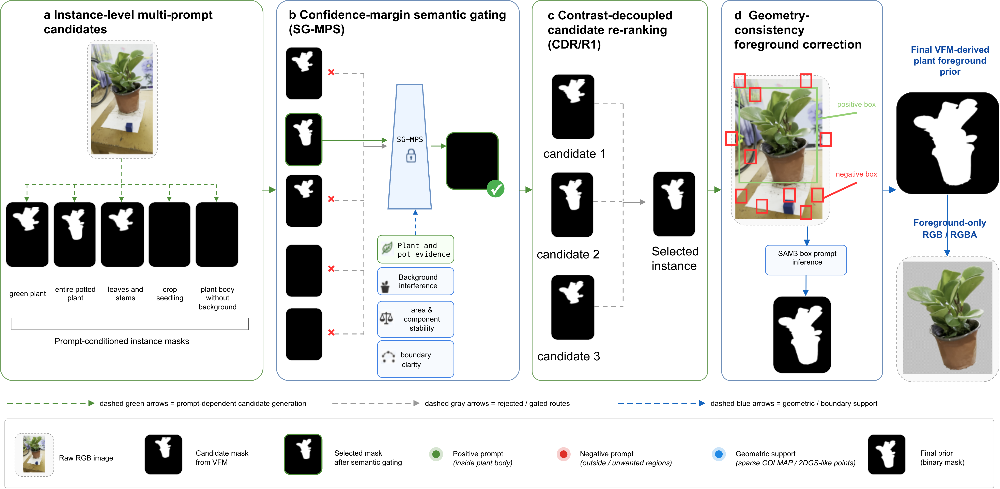
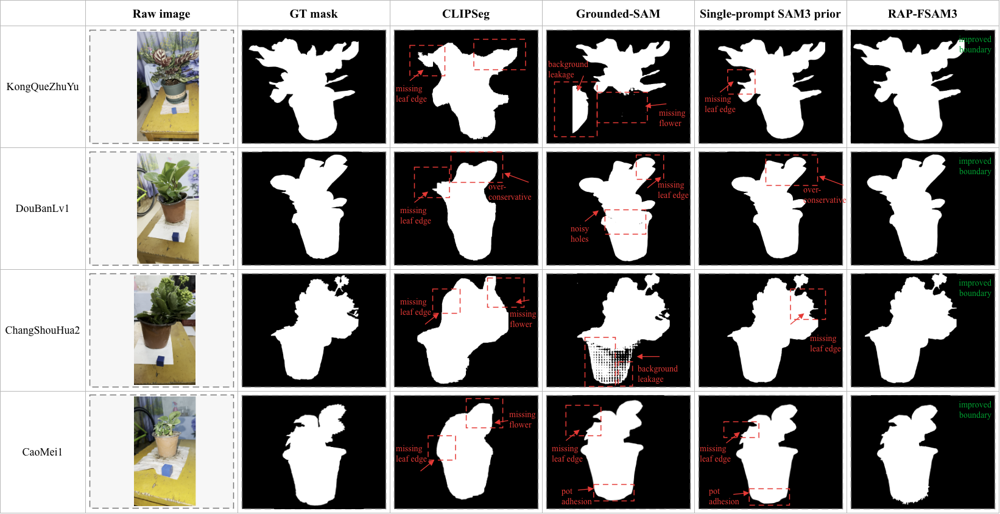
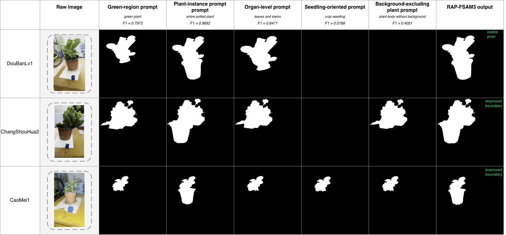

# ForeSplat｜中英文对照稿

> 来源：[ForeSplat.md](ForeSplat.md)。本稿用于逐段核查；英文在前、中文在后，图表和公式共用。章节和图表保留现有顺序，英文图表交叉引用改为可点击编号。Markdown 源码中的 `ForeSplat.md:L…` 注释标出底稿位置。

> 本文为修订草稿。英文 `TODO` 和中文“待补”提示保留在原处，未加入实验数据。需要修改论文或导出 LaTeX 时，以英文底稿为准。

导航：[摘要](#abstract-en-zh) · [引言](#sec-introduction) · [材料与方法](#sec-materials-and-methods) · [结果](#sec-results) · [讨论](#sec-discussion) · [结论](#sec-conclusion) · [待补事项索引](#pending-items)

<!-- ForeSplat.md:L2 -->

## Title / 题目

<!-- ForeSplat.md:L2 -->

**Original:** ForeSplat: Vision-Foundation-Model-Guided Metric Gaussian-to-Mesh Reconstruction for Organ-Level Phenotyping of Diverse Potted Plants

**中文:** ForeSplat：视觉基础模型引导的度量尺度高斯到网格重建，用于多类盆栽植物的器官级表型分析

<!-- ForeSplat.md:L3 -->

## Abstract / 摘要

<!-- ForeSplat.md:L4 -->

**Original:** Multiview RGB imaging provides an accessible route to plant phenotyping, but image masks alone do not define a three-dimensional surface with a physical scale or identify individual organs across views. ForeSplat combines reconstruction-aware prompt adaptation with centimetre-scale surface reconstruction and multiview leaf association. On manually annotated frames from 21 RGB sequences, RAP-FSAM3 achieved an F1-score of 0.9706, an mIoU of 0.9641 and a Boundary-F1 of 0.4643. For three-dimensional reconstruction, COLMAP camera poses and sparse points initialise Geometry-Grounded Gaussian Splatting (GGGS). A 2-cm reference cube anchors the scale, and median depths screened by the foreground mask and rendering alpha are fused using a truncated signed distance function (TSDF). Visible mesh triangles are then labelled across views to separate the plant from the pot and extract individual leaf surfaces. The reconstruction protocol covered 19 potted plants. [TODO: Add final calibration and mesh results.] [TODO: Add the agreement with same-specimen manual measurements.]

**中文:** 多视角 RGB 成像为植物表型分析提供了一种易于部署的途径，但仅凭图像掩膜，既不能确定具有物理尺度的三维表面，也不能跨视角识别同一器官。ForeSplat 将面向重建的提示词适配、厘米尺度的表面重建与多视角叶片关联相结合。在来自 21 条 RGB 序列的人工标注帧上，RAP-FSAM3 的 F1 分数、mIoU 和 Boundary-F1 分别为 0.9706、0.9641 和 0.4643。三维重建使用 COLMAP 的相机位姿和稀疏点初始化几何约束高斯泼溅（GGGS）。以边长 2 cm 的参考立方体确定尺度，并以截断符号距离函数（TSDF）融合经前景掩膜和渲染 alpha 值筛选的中值深度。随后，利用多视角信息标记可见网格三角面，以分离植物和花盆并提取单叶表面。重建流程覆盖 19 株盆栽植物。**[待补：最终标定和网格重建结果。] [待补：与同一样本人工测量的一致性结果。]**

<!-- ForeSplat.md:L5 -->

## Keywords / 关键词

<!-- ForeSplat.md:L6 -->

**Original:** vision foundation models; Gaussian Splatting; TSDF fusion; metric scale recovery; leaf instance reconstruction; plant phenotyping

**中文:** 视觉基础模型；高斯泼溅；TSDF 融合；度量尺度恢复；叶片实例重建；植物表型分析

<!-- ForeSplat.md:L22 -->

## Science4Impact Statement / Science4Impact 声明

<!-- ForeSplat.md:L24 -->

**Original:** ForeSplat converts multiview RGB images into centimetre-scale meshes of potted plants and exports separately inspectable leaf surfaces. The workflow keeps the link between each exported leaf and its supporting images, making it possible to check where a trait estimate comes from and to flag leaves with incompletely observed margins.

**中文:** ForeSplat 将多视角 RGB 图像转换为盆栽植物的厘米尺度网格，并导出可单独检查的叶片表面。流程保留每个导出叶片与支持该实例的图像之间的对应关系，便于追溯性状估计的依据，并标记叶缘未被完整观测的叶片。

<!-- ForeSplat.md:L26 -->

## Introduction / 引言

<!-- ForeSplat.md:L28 -->

**Original:** Plant phenotyping provides a technical bridge between genotype, environmental response and agronomic performance. Field high-throughput phenotyping has long been recognised as a bottleneck in translating genomic advances into measurable breeding progress [@ref1; @ref2]. Structural traits such as plant height, canopy width, leaf length and leaf width are widely used in breeding selection, cultivation management and growth assessment [@ref6; @ref56; @ref61]. Manual measurement is labour-intensive, low-throughput and sensitive to operator experience, whereas two-dimensional imaging cannot fully represent overlapping leaves, occluded organs and non-planar canopy geometry. Crop phenomics therefore calls for coordinated trait acquisition, data management and interpretation rather than imaging alone [@ref3]. Recent low-cost phenotyping systems likewise emphasise the need for accessible, scalable measurement pipelines [@ref62; @ref63]. High-throughput measurements can also help characterise diverse crop genetic resources at stages where conventional trait assessment is costly [@ref5]. Three-dimensional representations are therefore increasingly used to quantify plant structure, organ position and canopy morphology [@ref8; @ref10]. Recent reviews further show that 3D imaging and reconstruction are becoming central to trait detection and high-throughput phenotyping workflows [@ref9; @ref11; @ref12]. In practical potted-plant and controlled-environment settings, however, low-cost 3D phenotyping remains difficult because thin leaves, weak texture, repeated patterns, local occlusion, mixed flower--leaf structures and backgrounds with similar colours all reduce the robustness of reconstruction and measurement.

**中文:** 植物表型分析是联系基因型、环境响应与农艺表现的技术桥梁。长期以来，田间高通量表型测量被视为将基因组学进展转化为可量化育种进展的瓶颈 [@ref1; @ref2]。株高、冠幅、叶长和叶宽等结构性状广泛用于育种筛选、栽培管理和生长评估 [@ref6; @ref56; @ref61]。人工测量耗费人力、通量低，且受操作者经验影响；二维成像则无法充分表征重叠叶片、被遮挡的器官以及非平面的冠层几何。因此，作物表型组学不仅需要成像，还需要协调性状采集、数据管理和结果解读 [@ref3]。近期的低成本表型系统同样强调测量流程应易于部署且可扩展 [@ref62; @ref63]。在传统性状评估成本较高的阶段，高通量测量也有助于表征多样的作物遗传资源 [@ref5]。因此，三维表征越来越多地用于定量分析植物结构、器官位置与冠层形态 [@ref8; @ref10]。近期综述进一步指出，三维成像与重建正成为性状检测和高通量表型流程的核心环节 [@ref9; @ref11; @ref12]。不过，在实际的盆栽和受控环境中，薄叶、弱纹理、重复图案、局部遮挡、花叶混杂结构以及颜色相近的背景都会降低重建与测量的稳健性，使低成本三维表型分析仍面临困难。

<!-- ForeSplat.md:L30 -->

**Original:** Three-dimensional plant phenotyping has expanded from structure from motion, multiview stereo and depth sensing to neural rendering and explicit Gaussian representations. Earlier reviews of plant imaging delineated the complementary roles of visible-light, spectral, thermal and 3D sensing for extracting different traits [@ref4]. The value of geometry-based phenotyping lies in relating explicit 3D structure to measurable whole-plant and organ traits [@ref7]. LiDAR and depth-sensing systems can provide accurate point clouds, but their cost, calibration complexity and deployment requirements limit broad use in horticultural facilities and breeding trials [@ref14]. Structured-light reconstruction and time-of-flight imaging have likewise been explored for plant acquisition, including the reconstruction of maize plants [@ref13; @ref15]. Consumer RGB cameras are flexible and inexpensive, but SfM/MVS remains sensitive to view coverage, image sharpness and leaf texture, even as recent low-cost multiview pipelines show that RGB reconstruction can support crop spatial-geometry analysis beyond single-sample measurement [@ref18; @ref19]. Classical dense multiview stereo combines photometric agreement with cross-view visibility constraints to reconstruct scene surfaces from overlapping images [@ref17]. NeRF improves visual reconstruction through continuous radiance fields and compact neural encodings [@ref20; @ref21; @ref22]. Modular research frameworks such as Nerfstudio have also facilitated the development and evaluation of NeRF-based pipelines [@ref23]. Recent plant studies have used NeRF for field and indoor plant geometry assessment [@ref25; @ref26]. An evaluation across increasingly challenging plant scenes, including field conditions, further documented the trade-off between geometric fidelity and reconstruction efficiency [@ref24]. Comparative plant NeRF studies further indicate that neural rendering can support low-cost crop reconstruction under practical acquisition settings [@ref59]. 3D Gaussian Splatting (3DGS) and 2D Gaussian Splatting (2DGS) further provide explicit and editable scene representations [@ref27; @ref28]. Efficient Gaussian variants also explore compression and compact scene representation [@ref51; @ref52; @ref53]. Mini-splatting shows that constrained Gaussian counts can further reduce representation size [@ref54]. Plant3R and PlantGaussian show that Gaussian representations can support plant-structure reconstruction and visualisation [@ref30; @ref31]. Cotton3DGaussians and object-centric 3DGS further extend this route to boll mapping, plant architecture analysis and strawberry phenotyping [@ref32; @ref33]. These advances also leave a practical agricultural question unresolved: is the reconstructed 3D object the plant object that needs to be measured?

**中文:** 三维植物表型分析的技术路线已从运动恢复结构、多视角立体视觉和深度感知，扩展到神经渲染和显式高斯表征。早期植物成像综述阐明了可见光、光谱、热成像和三维感知在提取不同性状时的互补作用 [@ref4]。基于几何的表型分析，其价值在于将显式三维结构与可测量的整株和器官性状联系起来 [@ref7]。激光雷达和深度感知系统可提供精确点云，但成本、标定复杂度和部署要求限制了其在园艺设施与育种试验中的广泛应用 [@ref14]。结构光重建和飞行时间成像也被用于植物数据采集研究，包括玉米植株重建 [@ref13; @ref15]。消费级 RGB 相机灵活且成本低；尽管近期的低成本多视角流程表明，RGB 重建可支持超越单样本测量的作物空间几何分析 [@ref18; @ref19]，SfM/MVS 仍对视角覆盖、图像清晰度和叶片纹理较为敏感。经典稠密多视角立体视觉通过结合光度一致性和跨视角可见性约束，从相互重叠的图像重建场景表面 [@ref17]。NeRF 通过连续辐射场和紧凑的神经编码改善了视觉重建效果 [@ref20; @ref21; @ref22]。Nerfstudio 等模块化研究框架也促进了基于 NeRF 的流程开发与评估 [@ref23]。近期植物研究已将 NeRF 用于田间和室内植物的几何评估 [@ref25; @ref26]。一项覆盖难度逐步提高、并包含田间条件的植物场景评估进一步记录了几何保真度与重建效率之间的权衡 [@ref24]。植物 NeRF 的对比研究还表明，在实际采集条件下，神经渲染可支持低成本作物重建 [@ref59]。三维高斯泼溅（3DGS）和二维高斯泼溅（2DGS）进一步提供了显式、可编辑的场景表征 [@ref27; @ref28]。高效高斯变体也在探索压缩和紧凑场景表征 [@ref51; @ref52; @ref53]。Mini-splatting 表明，限制高斯基元的数量可进一步缩小表征规模 [@ref54]。Plant3R 和 PlantGaussian 展示了高斯表征在植物结构重建与可视化中的应用 [@ref30; @ref31]。Cotton3DGaussians 和面向对象的 3DGS 又将这一路线扩展到棉铃定位、株型分析与草莓表型分析 [@ref32; @ref33]。这些进展仍留下一个实际的农业问题：重建得到的三维对象，是否就是需要测量的植物对象？

<!-- ForeSplat.md:L32 -->

**Original:** A Gaussian representation fitted to multiview RGB images can reproduce appearance without uniquely defining the geometry needed for phenotyping. In potted plants, measurements depend on three additional requirements: a consistent physical scale, separation of the plant from its container, and association of each observed leaf across views. Thin margins and overlapping leaves make the last two requirements particularly difficult. Here, the potted-plant foreground is used as an initial image-space region of interest.

**中文:** 用多视角 RGB 图像拟合的高斯表征能够复现外观，却不能唯一确定表型测量所需的几何。在盆栽植物中，测量还需满足三个条件：具有一致的物理尺度、将植物与容器分离，以及跨视角关联每片被观测的叶片。薄叶缘和叶片重叠使后两项尤其困难。本文将盆栽植物前景作为图像空间中的初始感兴趣区域。

<!-- ForeSplat.md:L34 -->

**Original:** Vision foundation models provide promptable segmentation priors for plant phenotyping [@ref55], but individual prompts can include background vegetation, omit mature structures or truncate leaf margins. RAP-FSAM3 adapts these predictions to the potted-plant foreground task. We use the resulting foreground envelope to screen rendered depth observations, and use separate semantic and instance predictions to label visible mesh surfaces.

**中文:** 视觉基础模型（VFM）可为植物表型分析提供由提示词驱动的分割先验 [@ref55]，但单个提示词可能将背景植被纳入前景、漏掉成熟植株结构或截断叶缘。RAP-FSAM3 将这些预测适配到盆栽植物前景任务。我们使用由此得到的前景范围筛选渲染深度观测，并使用独立的语义和实例预测为可见网格表面赋予标签。

<!-- ForeSplat.md:L36 -->

**Original:** We present ForeSplat, a multiview RGB workflow that links calibrated surface reconstruction to plant and leaf measurements. Its contributions are: (1) RAP-FSAM3, which adapts promptable foreground segmentation to potted plants through semantic-gated candidate selection and structure-balanced refinement; (2) a metric Gaussian-to-mesh workflow that combines COLMAP, native GGGS, cube-based scale recovery and TSDF fusion; and (3) a multiview mesh-labelling procedure that separates plant and pot surfaces and exports individual leaf meshes with links to their supporting images.

**中文:** 本文提出 ForeSplat，一套将尺度标定后的表面重建与整株及叶片测量相联系的多视角 RGB 流程。主要贡献包括：（1）RAP-FSAM3，通过语义门控候选选择和结构平衡式细化，将提示驱动的前景分割适配到盆栽植物；（2）一套度量尺度的高斯到网格流程，结合 COLMAP、原生 GGGS、基于立方体的尺度恢复和 TSDF 融合；（3）一种多视角网格标注方法，将植物与花盆表面分离，并导出可追溯到支持图像的单叶网格。

<!-- ForeSplat.md:L38 -->

## Materials and Methods / 材料与方法

<!-- ForeSplat.md:L40 -->

### Study Design and Overall Workflow / 研究设计与总体流程

<!-- ForeSplat.md:L42 -->

**Original:** COLMAP estimates camera poses and a sparse point cloud from multiview RGB images. After registration and before GGGS training, the potted-plant foreground masks are aligned with the corresponding undistorted views. Native GGGS is fitted using unmasked RGB images and the COLMAP sparse points. After scale recovery, the aligned masks screen the rendered GGGS depth before TSDF fusion. Separate SAM3 predictions support reference-cube detection, plant–pot separation and multiview leaf association. Whole-plant and leaf traits are computed from the corresponding centimetre-scale surfaces. The workflow is summarised in [Fig. 1](#figure-1).

**中文:** COLMAP 根据多视角 RGB 图像估计相机位姿和稀疏点云。配准完成后、GGGS 训练前，将盆栽植物的前景掩膜与对应的去畸变视图对齐。原生 GGGS 使用未施加掩膜的 RGB 图像和 COLMAP 稀疏点进行拟合。恢复尺度后，在 TSDF 融合之前使用已对齐的掩膜筛选 GGGS 渲染深度。独立的 SAM3 预测用于参考立方体检测、植物与花盆分离以及多视角叶片关联。整株和叶片性状分别从相应的厘米尺度表面计算。整体流程见[图 1](#figure-1)。

<!-- ForeSplat.md:L44 -->

**Original:** **[TODO: Fig. 1. Replace with the new COLMAP, mask alignment, GGGS and TSDF workflow.]**

**中文:** **[待补：图 1。替换为包含 COLMAP、掩膜对齐、GGGS 与 TSDF 的新版流程图。]**

<!-- ForeSplat.md:L50 -->

#### Fig. 1 / 图 1

> Draft placeholder: Figure 1 / 草稿占位：图 1（现稿未提供新版图像）

<!-- ForeSplat.md:L50 -->

**Original:** Overview of ForeSplat. The foreground masks are aligned to undistorted COLMAP views before GGGS training and applied to the rendered depth before metric TSDF fusion. GGGS is trained on unmasked RGB images with COLMAP sparse-point initialisation. Mesh labelling separates the plant from the pot and associates leaves across views for trait extraction.

**中文:** ForeSplat 总览。GGGS 训练前，将前景掩膜对齐到 COLMAP 的去畸变视图；在度量尺度 TSDF 融合前，将掩膜用于筛选渲染深度。GGGS 使用未施加掩膜的 RGB 图像训练，并以 COLMAP 稀疏点初始化。网格标注将植物与花盆分开，并跨视角关联叶片以提取性状。

<!-- ForeSplat.md:L58 -->

### Datasets and Evaluation Protocols / 数据集与评估方案

<!-- ForeSplat.md:L60 -->

**Original:** We used three experimental protocols ([Table 1](#table-1)). The foreground-prior evaluation used manually annotated frames from 21 multiview RGB sequences. For backend selection, we tested five Gaussian configurations on one development plant (KongQueZhuYu) using a common COLMAP reconstruction, 183 training views and 27 held-out views. The multi-plant workflow covered 19 potted plants spanning nine recorded plant types: four development plants and 15 held out from workflow development ([Table 2](#table-2)). 

**中文:** 本研究采用三套实验方案（[表 1](#table-1)）。前景先验评估使用 21 条多视角 RGB 序列中的人工标注帧。后端选型时，我们在一株开发样本（KongQueZhuYu）上测试了五种高斯配置，共用同一份 COLMAP 重建结果，并使用 183 个训练视图和 27 个留出视图。多植株流程覆盖 19 株盆栽植物，涉及 9 类记录的植物，其中 4 株用于开发，15 株未参与流程开发（[表 2](#table-2)）。

<!-- ForeSplat.md:L64 -->

#### Table 1 / 表 1

<!-- ForeSplat.md:L64 -->

**Original:** Datasets and evaluation protocols for the ForeSplat study.

**中文:** ForeSplat 研究所用的数据集与评估方案。

<!-- ForeSplat.md:L69 -->

| Protocol 评估方案 | Evaluation units 评估单元 | Purpose 用途 |
| --- | --- | --- |
| Foreground-prior evaluation 前景先验评估 | Annotated frames from 21 RGB sequences 来自 21 条 RGB 序列的标注帧 | VFM comparison, prompt sensitivity and RAP-FSAM3 ablation VFM 对比、提示词敏感性分析和 RAP-FSAM3 消融实验 |
| Single-plant backend selection 单株后端选型 | 1 plant; 183 training views and 27 held-out views 1 株植物；183 个训练视图和 27 个留出视图 | Comparison of Gaussian configurations and mesh extraction 比较高斯配置与网格提取方案 |
| Multi-plant reconstruction 多植株重建 | 19 plants across 9 recorded plant types 涵盖 9 类记录植物的 19 株样本 | Metric calibration, reconstruction and leaf instance extraction 度量尺度标定、重建及单叶实例提取 |
| Manual-reference comparison 人工参考测量对照 | 57 identity-matched leaves; valid pairs pending by trait 57 片已核验身份对应的叶片；各性状有效配对数待定 | Plant height, canopy width, leaf length and leaf width 株高、冠幅、叶长和叶宽 |

<!-- ForeSplat.md:L82 -->

#### Table 2 / 表 2

<!-- ForeSplat.md:L82 -->

**Original:** Plant types recorded in the 19-plant reconstruction dataset. These labels are dataset identifiers.

**中文:** 19 株重建数据集中记录的植物类型。这些标签为数据集标识。

<!-- ForeSplat.md:L87 -->

| Recorded plant type 记录的植物类型 | Total 总数 | Development 开发组 | Held-out workflow assessment 留出流程评估组 |
| --- | --- | --- | --- |
| CaoMei 草莓 | 2 | 0 | 2 |
| ChangShouHua 长寿花 | 3 | 1 | 2 |
| DouBanLv 豆瓣绿 | 3 | 0 | 3 |
| HongZhang 红掌 | 1 | 0 | 1 |
| KongQueZhuYu 孔雀竹芋 | 1 | 1 | 0 |
| WanNianQing 万年青 | 2 | 0 | 2 |
| WangWenCao 网纹草 | 2 | 1 | 1 |
| XianKeLai 仙客来 | 3 | 0 | 3 |
| XiangPiShu 橡皮树 | 2 | 1 | 1 |
| Total 合计 | 19 | 4 | 15 |

<!-- ForeSplat.md:L108 -->

### RAP-FSAM3: Reconstruction-Aware Prompt-Adaptive Foreground Priors / RAP-FSAM3：面向重建的提示词自适应前景先验

<!-- ForeSplat.md:L110 -->

**Original:** RAP-FSAM3 is designed to generate potted-plant foreground priors for 3D reconstruction rather than to serve as an independent general segmentation model. Its input is the raw multiview RGB frames of each plant.

**中文:** RAP-FSAM3 用于为盆栽植物三维重建生成前景先验，而非作为独立的通用分割模型。其输入为每株植物的原始多视角 RGB 帧。

<!-- ForeSplat.md:L112 -->

**Original:** RAP-FSAM3 produces a binary mask, an alpha image and a foreground RGB image aligned to each processed RGB frame. The binary mask supplies the potted-plant depth-screening envelope where an archived mask is available; missing envelopes are replaced by direct SAM3 potted-plant predictions. The masked RGB images are not used for GGGS photometric optimisation.

**中文:** RAP-FSAM3 为每个处理后的 RGB 帧生成与其对齐的二值掩膜、alpha 图像和前景 RGB 图像。有已归档的掩膜时，使用该二值掩膜限定待筛选的盆栽深度范围；缺少对应掩膜时，则以 SAM3 对盆栽植物的直接预测补充。施加掩膜后的 RGB 图像不参与 GGGS 的光度优化。

<!-- ForeSplat.md:L114 -->

**Original:** RAP-FSAM3 first removes severely blurred frames through frequency-domain quality filtering and then adapts VFM masks to the reconstruction task through multi-prompt candidate generation, semantic-gated selection and foreground--background prompt refinement.

**中文:** RAP-FSAM3 先通过频域质量筛选去除严重模糊的帧，再通过多提示词候选生成、语义门控选择和前景–背景提示细化，将 VFM 掩膜适配到重建任务。

<!-- ForeSplat.md:L116 -->

#### FFT-Based Frame-Quality Filtering / 基于 FFT 的帧质量筛选

<!-- ForeSplat.md:L118 -->

**Original:** Blurred, defocused and weakly textured frames can affect SfM pose estimation, VFM mask boundaries and downstream surface reconstruction. Comparative studies of focus-measure operators show that their responses depend on image properties and acquisition conditions, motivating an adaptive quality criterion [@ref50]. We computed the two-dimensional FFT magnitude spectrum for each frame and used a normalised high-frequency saliency index rather than an absolute high-frequency sum:

**中文:** 模糊、失焦和纹理较弱的图像帧可能影响 SfM 位姿估计、VFM 掩膜边界及后续的表面重建。聚焦度评价算子的对比研究表明，其响应取决于图像属性和采集条件，因此有必要采用自适应质量判据 [@ref50]。我们计算每帧的二维 FFT 幅度谱，使用归一化的高频显著性指标，而非高频分量的绝对和值：

<!-- ForeSplat.md:L120 -->

$$
Q_{\text{FFT}}(I)=
\frac{\left\| W_H\odot \log\left(1+\left|\mathcal{F}(I)\right|\right)\right\|_1}
{\left\| \log\left(1+\left|\mathcal{F}(I)\right|\right)\right\|_1+\varepsilon} .
$$

<!-- ForeSplat.md:L124 -->

**Original:** Here, $I$ denotes the input frame after conversion to grayscale for quality evaluation, and $\mathcal{F}(I)$ denotes its two-dimensional Fourier transform. The term $|\mathcal{F}(I)|$ is the magnitude spectrum, and $\log(1+|\mathcal{F}(I)|)$ compresses the dynamic range of the spectrum so that a few extremely strong low-frequency components do not dominate the score. $W_H\in[0,1]^{H\times W}$ is a radial high-pass weighting mask, where entries close to the spectral centre receive low weights and high-frequency regions receive large weights. The operator $\odot$ denotes element-wise multiplication, $\|\cdot\|_1$ sums the weighted spectral responses, and $\varepsilon$ is a small constant used to avoid division by zero. Therefore, $Q_{\text{FFT}}(I)$ is a normalised high-frequency saliency score: a larger value indicates that the frame contains richer edges and details and is less likely to be severely blurred. The distribution of $Q_{\text{FFT}}$ was computed independently for each sequence, and the first quartile was used as a sample-adaptive threshold. Frames below this threshold were excluded from subsequent segmentation and COLMAP processing.

**中文:** 其中，$I$ 表示为评估画质而转为灰度的输入帧，$\mathcal{F}(I)$ 表示其二维傅里叶变换。$|\mathcal{F}(I)|$ 为幅度谱，$\log(1+|\mathcal{F}(I)|)$ 用于压缩频谱的动态范围，以免少量极强的低频分量主导得分。$W_H\in[0,1]^{H\times W}$ 为径向高通加权掩膜，频谱中心附近的元素权重较低，高频区域权重较高。算子 $\odot$ 表示逐元素相乘，$\|\cdot\|_1$ 对加权后的频谱响应求和，$\varepsilon$ 是防止除零的小常数。因此，$Q_{\text{FFT}}(I)$ 是归一化的高频显著性得分：分值越大，说明该帧的边缘和细节越丰富，严重模糊的可能性越低。各序列独立计算 $Q_{\text{FFT}}$ 的分布，并将第一四分位数作为该序列的自适应阈值。低于阈值的帧不参与后续分割与 COLMAP 处理。

<!-- ForeSplat.md:L126 -->

#### Multi-Prompt VFM Candidate Generation / 基于多提示词的 VFM 候选生成

<!-- ForeSplat.md:L128 -->

**Original:** Frames that passed quality filtering were input to the VFM. Promptable segmentation models have shown strong general foreground localisation in natural-image and video segmentation [@ref38; @ref39; @ref71]. Plant point-cloud segmentation studies indicate that learned 3D segmentation can support organ-level structural analysis [@ref42; @ref43]. Earlier work on plant-part segmentation also showed that integrating information from multiple views can improve organ-level interpretation relative to isolated two-dimensional predictions [@ref41]. Recent open-vocabulary methods have broadened prompt-based object perception for complex scenes [@ref40; @ref64]. Point Transformer V3 further strengthens general-purpose 3D representation learning [@ref44]. For each frame $I_i$, RAP-FSAM3 queries the VFM using five plant-related prompts: a green-region prompt, `green plant`; a plant-instance prompt, `entire potted plant`; an organ-level prompt, `leaves and stems`; a seedling-oriented prompt, `crop seedling`; and a background-excluding plant prompt, `plant body without background`. For frame $I_i$ and prompt $P_k$, let the instance-wise candidate set returned by the VFM be

**中文:** 将通过质量筛选的帧输入 VFM。提示驱动的分割模型已在自然图像和视频分割中表现出较强的通用前景定位能力 [@ref38; @ref39; @ref71]。植物点云分割研究表明，基于学习的三维分割能够支持器官级结构分析 [@ref42; @ref43]。较早的植物部件分割研究也表明，与仅使用各自独立的二维预测相比，融合多个视角的信息可改善器官级解读 [@ref41]。近期开放词汇方法拓展了复杂场景中基于提示词的物体感知能力 [@ref40; @ref64]。Point Transformer V3 则进一步增强了通用三维表征学习能力 [@ref44]。对每帧 $I_i$，RAP-FSAM3 使用五种与植物相关的提示词查询 VFM：绿色区域提示词 `green plant`、整盆植株实例提示词 `entire potted plant`、器官级提示词 `leaves and stems`、幼苗提示词 `crop seedling`，以及排除背景的植物体提示词 `plant body without background`。给定帧 $I_i$ 和提示词 $P_k$，VFM 返回的逐实例候选集合定义为

<!-- ForeSplat.md:L130 -->

$$
\mathcal{C}_i^{(k)}=\left\{c_{i,j}^{(k)}\right\}_{j=1}^{N_{i,k}},\qquad k\in\{1,\ldots,5\},
$$

<!-- ForeSplat.md:L132 -->

**Original:** and let the frame's full candidate pool be

**中文:** 该帧的全部候选集合定义为

<!-- ForeSplat.md:L134 -->

$$
\mathcal{C}_i=\bigcup_{k=1}^{5}\mathcal{C}_i^{(k)}.
$$

<!-- ForeSplat.md:L136 -->

**Original:** Here, $i$ is the frame index, $k$ is the prompt index, $N_{i,k}$ is the number of instance candidates returned by prompt $P_k$ for frame $i$, and $c_{i,j}^{(k)}$ denotes the $j$-th candidate produced by the $k$-th prompt, which includes at minimum its binary mask $M_{i,j}^{(k)}\in\{0,1\}^{H\times W}$, source prompt identifier, and candidate confidence information from the segmentation model. This set-based formulation makes explicit that each prompt may return multiple instance candidates in instance-wise mode, rather than the simplified representation where each prompt corresponds to a single mask. The plant-instance prompt is defined as a potted-plant foreground prompt rather than a strict plant-body-only prompt, because in the collected scenes the VFM often treats the plant and its visible supporting container as one coherent foreground instance. This design allows the method to expose and handle prompt-induced semantic bias instead of relying on a single fixed textual description.

**中文:** 其中，$i$ 为帧索引，$k$ 为提示词索引，$N_{i,k}$ 为提示词 $P_k$ 在第 $i$ 帧返回的实例候选数；$c_{i,j}^{(k)}$ 是第 $k$ 个提示词生成的第 $j$ 个候选，至少包含二值掩膜 $M_{i,j}^{(k)}\in\{0,1\}^{H\times W}$、来源提示词标识以及分割模型给出的候选置信度信息。这种集合表示明确区分了逐实例模式下每个提示词可返回多个候选的情形，而不是简化为一个提示词对应一个掩膜。整盆植株实例提示词的目标定义为盆栽植物前景，而不是严格限定为植物本体，因为在所采集的场景中，VFM 常将植物与可见的承托容器视作同一个完整前景实例。这一设计有助于识别并处理提示词引起的语义偏差，而不依赖单一固定描述。

<!-- ForeSplat.md:L138 -->

#### Semantic-Gated Multi-Prompt Selection / 语义门控多提示词选择

<!-- ForeSplat.md:L140 -->

**Original:** A naive prompt selector that considers only mask geometry may choose a semantically inappropriate candidate, such as an organ-only or seedling-oriented mask in a mature potted plant. RAP-FSAM3 therefore uses semantic-gated multi-prompt selection. For each candidate mask, we construct a foreground-prior descriptor

**中文:** 仅考虑掩膜几何的简单选择器可能选中语义不合适的候选，例如在成熟盆栽中选到仅包含部分器官的掩膜或针对幼苗的掩膜。因此，RAP-FSAM3 使用语义门控多提示词选择。我们为每个候选掩膜构建前景先验描述向量

<!-- ForeSplat.md:L142 -->

$$
\boldsymbol{\phi}_i^{(k)}=\left[
q_{\text{plant}},\ q_{\text{pot}},\ q_{\text{area}},\ q_{\text{comp}},\ q_{\text{edge}},\ q_{\text{contrast}},\ q_{\text{temp}}
\right]^{\top},
$$

<!-- ForeSplat.md:L146 -->

**Original:** and an interference descriptor

**中文:** 与干扰描述向量

<!-- ForeSplat.md:L148 -->

$$
\boldsymbol{\psi}_i^{(k)}=\left[
q_{\text{table}},\ q_{\text{bg}},\ q_{\text{neighbour}},\ q_{\text{outlier}}
\right]^{\top}.
$$

<!-- ForeSplat.md:L152 -->

**Original:** The semantic compatibility of the $k$-th candidate is modelled as a gated confidence score

**中文:** 第 $k$ 个候选的语义相容性表示为门控置信度分数

<!-- ForeSplat.md:L154 -->

$$
s_i^{(k)}=\mathbf{w}_{\phi}^{\top}\boldsymbol{\phi}_i^{(k)}
-\mathbf{w}_{\psi}^{\top}\boldsymbol{\psi}_i^{(k)}-b,
\qquad c_i^{(k)}=\sigma\!\left(s_i^{(k)}\right),
$$

<!-- ForeSplat.md:L158 -->

**Original:** In these equations, $\boldsymbol{\phi}_i^{(k)}$ describes the foreground reliability of the $k$-th candidate in frame $i$. Specifically, $q_{\text{plant}}$ measures plant-body semantic evidence via reference recall against plant reference regions, $q_{\text{pot}}$ measures consistency with the complete potted-plant target definition when a visible supporting container is present, $q_{\text{area}}$ measures whether the foreground area lies in a reasonable range, $q_{\text{comp}}$ penalises fragmented connected components, $q_{\text{edge}}$ measures boundary clarity, $q_{\text{contrast}}$ measures foreground-background appearance separability, and $q_{\text{temp}}$ measures temporal consistency with neighbouring frames. The vector $\boldsymbol{\psi}_i^{(k)}$ describes external interference evidence, where $q_{\text{table}}$, $q_{\text{bg}}$, $q_{\text{neighbour}}$ and $q_{\text{outlier}}$ measure the degree to which the candidate leaks into table regions, distant background regions, neighbouring plants and isolated outlier fragments. In the current implementation, pot evidence is treated as positive cue with weight $w_{\text{pot}}=0.2$. Plant reference evidence adopts a reference-recall formulation; the green reference component is selected from green connected components as the component whose union with the candidate mask has the largest overlap. Because this work defines the complete potted plant as the target object, the visible container is not treated as a background negative class. Container regions are anchored based on plant-base detection. $\mathbf{w}_{\phi}$ and $\mathbf{w}_{\psi}$ are weighting vectors for foreground reliability and interference evidence, $b$ is a bias term, and $\sigma(\cdot)$ is the sigmoid function that maps the semantic compatibility score to $[0,1]$. Thus, $c_i^{(k)}$ represents the semantic compatibility of the $k$-th candidate. Candidate reliability is then normalised through a temperature-controlled softmax,

**中文:** 式中，$\boldsymbol{\phi}_i^{(k)}$ 描述第 $i$ 帧中第 $k$ 个候选作为前景的可靠性。具体而言，$q_{\text{plant}}$ 通过计算候选对植物参考区域的召回率衡量植物体的语义证据；$q_{\text{pot}}$ 在承托容器可见时衡量候选与完整盆栽目标定义的一致性；$q_{\text{area}}$ 衡量前景面积是否在合理范围内；$q_{\text{comp}}$ 对碎片化的连通分量施加惩罚；$q_{\text{edge}}$ 衡量边界清晰度；$q_{\text{contrast}}$ 衡量前景与背景在外观上的可分性；$q_{\text{temp}}$ 衡量与相邻帧的时序一致性。向量 $\boldsymbol{\psi}_i^{(k)}$ 描述外部干扰证据，其中 $q_{\text{table}}$、$q_{\text{bg}}$、$q_{\text{neighbour}}$ 和 $q_{\text{outlier}}$ 分别衡量候选掩膜误纳入桌面、远处背景、相邻植株和孤立离群碎片的程度。当前实现将花盆证据视为正向线索，权重为 $w_{\text{pot}}=0.2$。植物参考证据采用参考召回率形式；在绿色连通分量中，选取其与候选掩膜的并集重叠最大的分量作为绿色参考分量。本文将完整盆栽定义为目标对象，因此不将可见容器视作背景负类。容器区域根据植物基部检测结果定位。$\mathbf{w}_{\phi}$ 和 $\mathbf{w}_{\psi}$ 分别是前景可靠性与干扰证据的权重向量，$b$ 为偏置项，$\sigma(\cdot)$ 为将语义相容性分数映射到 $[0,1]$ 的 sigmoid 函数。因此，$c_i^{(k)}$ 表示第 $k$ 个候选的语义相容性。接着，通过带温度参数的 softmax 对候选可靠性归一化：

<!-- ForeSplat.md:L160 -->

$$
a_i^{(k)}=\frac{\exp\left(c_i^{(k)}/\tau\right)}
{\sum_{l=1}^{5}\exp\left(c_i^{(l)}/\tau\right)},\qquad k=1,\ldots,5.
$$

<!-- ForeSplat.md:L163 -->

**Original:** where $a_i^{(k)}$ is the normalised reliability assigned to the $k$-th candidate and $\tau=0.25$ is the softmax temperature controlling how sharply the method selects among prompts. A smaller $\tau$ makes the selection closer to a hard argmax, whereas a larger value makes the reliability distribution smoother. Let $a_{i,(1)}$ and $a_{i,(2)}$ denote the highest and second-highest confidence scores after sorting, and define the confidence gap $\Delta_i=a_{i,(1)}-a_{i,(2)}$. SG-MPS uses a selective decision rule with threshold $\delta=0.05$:

**中文:** 其中，$a_i^{(k)}$ 为第 $k$ 个候选的归一化可靠性，$\tau=0.25$ 为 softmax 温度，控制提示词选择的区分程度。$\tau$ 越小，选择越接近直接取最大值；$\tau$ 越大，可靠性分布越平缓。设排序后置信度最高和次高的分数分别为 $a_{i,(1)}$ 和 $a_{i,(2)}$，将置信度差定义为 $\Delta_i=a_{i,(1)}-a_{i,(2)}$。SG-MPS 采用阈值为 $\delta=0.05$ 的选择性决策规则：

<!-- ForeSplat.md:L165 -->

$$
g_i=\begin{cases}
P_{(1)}, & \Delta_i\geq\delta,\\
\varnothing, & \Delta_i<\delta,
\end{cases}
\qquad \delta=0.05.
$$

<!-- ForeSplat.md:L171 -->

**Original:** When $\Delta_i\geq 0.05$, SG-MPS outputs the prompt $P_{(1)}$ corresponding to the highest confidence; when $\Delta_i<0.05$, the module outputs an empty decision $\varnothing$, meaning it does not independently determine the prompt based on gating scores but instead delegates the candidate instance decision to the subsequent CDR/R1 ranking step. This mechanism allows the model to selectively abstain when prompt semantic advantage is insufficient, rather than forcing a unique prompt output for every frame.

**中文:** 当 $\Delta_i\geq 0.05$ 时，SG-MPS 输出置信度最高的提示词 $P_{(1)}$；当 $\Delta_i<0.05$ 时，模块输出空决策 $\varnothing$，即不单独根据门控分数确定提示词，而是将候选实例的选择交给后续的 CDR/R1 排序。该机制允许模型在提示词的语义优势不足时暂不决策，而不强制每帧输出唯一的提示词。

<!-- ForeSplat.md:L173 -->

#### Contrast-Decoupled Re-ranking / 对比度解耦重排序

<!-- ForeSplat.md:L175 -->

**Original:** After SG-MPS completes semantic evaluation of candidates, RAP-FSAM3 uses a contrast-decoupled re-ranking strategy (CDR) to rank candidate instances. The goal of CDR is to reduce the dependence of candidate ranking on foreground--background appearance contrast, making target selection rely more on structure and semantic evidence relevant to the potted-plant instance. This module does not change the pixel boundaries of candidate masks; instead, it changes the relative ordering of candidates and outputs a target candidate for use by SB-FBPR.

**中文:** SG-MPS 完成候选的语义评估后，RAP-FSAM3 使用对比度解耦重排序策略（CDR）对候选实例排序。CDR 旨在降低排序对前景和背景外观对比度的依赖，使目标选择更多依靠与盆栽植物实例相关的结构与语义证据。该模块不改变候选掩膜的像素边界，只调整候选的相对排序，并向 SB-FBPR 提供选定的目标候选。

<!-- ForeSplat.md:L177 -->

**Original:** Let the prompt-level gating state output by SG-MPS be $g_i$, and the candidate pool be $\mathcal{C}_i$. The CDR/R1 selection process can be expressed as

**中文:** 设 SG-MPS 输出的提示词层级门控状态为 $g_i$，候选池为 $\mathcal{C}_i$。CDR/R1 的选择过程可表示为

<!-- ForeSplat.md:L179 -->

$$
c_i^{\star}=\underset{c\in\mathcal{C}_i}{\operatorname{arg\,max}}\;S_{\mathrm{R1}}(c\mid g_i),
\qquad M_i^{\mathrm{cand}}=\operatorname{Mask}(c_i^{\star}),
$$

<!-- ForeSplat.md:L182 -->

**Original:** where $S_{\mathrm{R1}}(c\mid g_i)$ denotes the R1 candidate ranking score computed under the SG-MPS gating state; when $g_i$ is a high-confidence prompt, that prompt information participates in candidate instance ranking; when $g_i=\varnothing$, R1 determines the target instance based on candidate ranking scores. $c_i^{\star}$ is the selected candidate instance, and $M_i^{\mathrm{cand}}$ is its initial mask.

**中文:** 其中，$S_{\mathrm{R1}}(c\mid g_i)$ 表示在 SG-MPS 门控状态下计算的 R1 候选排序分数。当 $g_i$ 是高置信度提示词时，其信息参与候选实例排名；当 $g_i=\varnothing$ 时，R1 根据候选排序分数确定目标实例。$c_i^{\star}$ 是选定的候选实例，$M_i^{\mathrm{cand}}$ 是其初始掩膜。

<!-- ForeSplat.md:L184 -->

#### Structure-Balanced Foreground--Background Prompt Refinement / 结构平衡式前景–背景提示细化

<!-- ForeSplat.md:L186 -->

**Original:** After CDR/R1 determines the target candidate, structure-balanced foreground--background prompt refinement (SB-FBPR) constructs positive and negative bounding-box prompts based on the target candidate and uses SAM3 for a second segmentation inference. The current method uses one positive bounding box to locate the target potted-plant instance and eight negative bounding boxes to represent interference regions around the target; the negative prompt regions are constructed through a ring strategy around the target boundary, providing spatially constrained background prompts outside the foreground boundary. Let the target candidate mask be $M_i^{\mathrm{cand}}$ and the dilation radius be $r$. The ring-style negative prompt region can be conceptually expressed as

**中文:** CDR/R1 确定目标候选后，结构平衡式前景–背景提示细化（SB-FBPR）根据该候选构建正、负边界框提示，并使用 SAM3 进行第二次分割推理。当前方法使用 1 个正框定位目标盆栽植物实例，使用 8 个负框表示目标周围的干扰区域。负提示区域通过沿目标边界构建环带来确定，从而为前景边界以外的区域提供有空间约束的背景提示。设目标候选掩膜为 $M_i^{\mathrm{cand}}$、膨胀半径为 $r$，则环带式负提示区域可表示为

<!-- ForeSplat.md:L188 -->

$$
\mathcal{R}_i^{-}=\operatorname{Dilate}(M_i^{\mathrm{cand}},r)\setminus M_i^{\mathrm{cand}}.
$$

<!-- ForeSplat.md:L190 -->

**Original:** Within this region, eight negative bounding boxes $\mathcal{B}_i^{-}=\{B_{i,1}^{-},\ldots,B_{i,8}^{-}\}$ are constructed, and one positive bounding box $B_i^{+}$ represents the target candidate. The second segmentation process of SAM3 can be expressed as

**中文:** 在该区域内构建 8 个负框 $\mathcal{B}_i^{-}=\{B_{i,1}^{-},\ldots,B_{i,8}^{-}\}$，另以 1 个正框 $B_i^{+}$ 表示目标候选。SAM3 的第二次分割可表示为

<!-- ForeSplat.md:L192 -->

$$
M_i^{\mathrm{final}}=\operatorname{SAM3}\!\left(I_i,B_i^{+},\mathcal{B}_i^{-}\right),
$$

<!-- ForeSplat.md:L194 -->

**Original:** where $I_i$ is the input image, $B_i^{+}$ is the positive target box, $\mathcal{B}_i^{-}$ is the set of eight negative bounding boxes, and $M_i^{\mathrm{final}}$ is the final foreground mask. This step converts candidate instance selection into a re-segmentation process with target and interference spatial prompts. The complete RAP-FSAM3 foreground-prior generation process is summarised in [Fig. 2](#figure-2).

**中文:** 其中，$I_i$ 为输入图像，$B_i^{+}$ 为目标正框，$\mathcal{B}_i^{-}$ 为 8 个负框组成的集合，$M_i^{\mathrm{final}}$ 为最终前景掩膜。此步骤在选定候选实例后，利用目标与干扰区域的空间提示进行再分割。RAP-FSAM3 的完整前景先验生成流程见[图 2](#figure-2)。

#### Algorithm 1 / 算法 1

<!-- ForeSplat.md:L199 -->

**Original:** RAP-FSAM3 foreground candidate selection and prompt-guided segmentation.

**中文:** RAP-FSAM3 前景候选选择与提示引导分割。

<!-- ForeSplat.md:L203 -->

**Original:** **Input:** image $I_i$; prompts $\mathcal{P}=\{P_1,\ldots,P_5\}$; frozen SAM3; $\tau=0.25$; $\delta=0.05$

**中文:** **输入：**图像 $I_i$；提示词集合 $\mathcal{P}=\{P_1,\ldots,P_5\}$；冻结的 SAM3；$\tau=0.25$；$\delta=0.05$

<!-- ForeSplat.md:L204 -->

**Original:** **Output:** final foreground mask $M_i^{\mathrm{final}}$

**中文:** **输出：**最终前景掩膜 $M_i^{\mathrm{final}}$

| Step / 步骤 | Original | 中文 |
| --- | --- | --- |
| 1 | $\mathcal{C}_i\gets\varnothing$ | 同左 / Same |
| 2 | **for** each prompt $P_k\in\mathcal{P}$ **do** | **对**每个提示词 $P_k\in\mathcal{P}$ **执行** |
| 3 | $\mathcal{C}_i^{(k)}\gets\operatorname{SAM3}(I_i,P_k;\,\text{instance-wise mode})$ | （逐实例模式） |
| 4 | $\mathcal{C}_i\gets\mathcal{C}_i\cup\mathcal{C}_i^{(k)}$ | 同左 / Same |
| 5 | **end for** | **结束循环** |
| 6 | Compute semantic confidence $c_i^{(k)}$ for $P_1$--$P_5$ and softmax weight $a_i^{(k)}$ using $\tau$ | 计算 $P_1$ 至 $P_5$ 的语义置信度 $c_i^{(k)}$，并使用 $\tau$ 计算 softmax 权重 $a_i^{(k)}$ |
| 7 | $\Delta_i\gets a_{i,(1)}-a_{i,(2)}$ | 同左 / Same |
| 8 | **if** $\Delta_i\geq\delta$ **then** | **若** $\Delta_i\geq\delta$ **则** |
| 9 | $g_i\gets P_{(1)}$ (selective semantic-gating output) | （选择性语义门控输出） |
| 10 | **else** | **否则** |
| 11 | $g_i\gets\varnothing$ (selective abstention) | （选择性弃权） |
| 12 | **end if** | **结束条件判断** |
| 13 | $c_i^{\star}\gets\underset{c\in\mathcal{C}_i}{\operatorname{arg\,max}}\,S_{\mathrm{R1}}(c\mid g_i)$ | 同左 / Same |
| 14 | $M_i^{\mathrm{cand}}\gets\operatorname{Mask}(c_i^{\star})$ | 同左 / Same |
| 15 | Construct one positive box $B_i^+$ and eight negative boxes $\mathcal{B}_i^-$ using the ring strategy | 使用环带策略构建 1 个正框 $B_i^+$ 和 8 个负框 $\mathcal{B}_i^-$ |
| 16 | $M_i^{\mathrm{final}}\gets\operatorname{SAM3}(I_i,B_i^+,\mathcal{B}_i^-)$ | 同左 / Same |
| 17 | **return** $M_i^{\mathrm{final}}$ | **返回** $M_i^{\mathrm{final}}$ |

<!-- ForeSplat.md:L227 -->

#### Fig. 2 / 图 2

<!-- ForeSplat.md:L227 -->

**Original:** RAP-FSAM3 foreground-prior generation. The module adapts VFM outputs to potted-plant reconstruction through semantic-gated multi-prompt selection and structure-balanced foreground--background prompt refinement.

**中文:** RAP-FSAM3 前景先验生成。该模块通过语义门控多提示词选择和结构平衡式前景–背景提示细化，使 VFM 输出适用于盆栽植物重建。

<!-- ForeSplat.md:L233 -->

### COLMAP and Geometry-Grounded Gaussian Splatting / COLMAP 与几何约束高斯泼溅

<!-- ForeSplat.md:L235 -->

**Original:** Camera intrinsics, poses and sparse points were obtained from COLMAP structure from motion [@ref16]. After COLMAP registration and before GGGS training, we mapped the potted-plant foreground masks to the image coordinates of the corresponding undistorted RGB views and stored them separately. The masks were later used to screen GGGS-rendered depth before TSDF fusion.

**中文:** 相机内参、位姿及稀疏点通过 COLMAP 的运动恢复结构流程获得 [@ref16]。COLMAP 注册完成后、GGGS 训练开始前，我们将盆栽植物前景掩膜映射到对应去畸变 RGB 视图的图像坐标系，并将其单独保存。后续在 TSDF 融合前，这些掩膜用于筛选 GGGS 渲染的深度。

<!-- ForeSplat.md:L237 -->

**Original:** Native GGGS (Zhang et al., *Grounding Gaussian Splatting Geometry with Stochastic Solids*) was trained on the undistorted RGB images without masking and initialised with the COLMAP sparse points without foreground filtering. The run used 30,000 iterations, spherical harmonic degree 3, spherical Gaussian degree 0 and seed 0. The native photometric, depth–normal and multiview regularisation terms were retained. For meshing, we use the median camera-axis depth returned by the GGGS renderer.

**中文:** 原生 GGGS（Zhang 等，*Grounding Gaussian Splatting Geometry with Stochastic Solids*）使用未施加掩膜的去畸变 RGB 图像训练，并用未经前景筛选的 COLMAP 稀疏点初始化。训练使用 30,000 次迭代，球谐函数阶数为 3，球面高斯阶数为 0，随机种子为 0。保留原生的光度、深度–法向及多视角正则化项。网格提取使用 GGGS 渲染器输出的沿相机轴方向的中值深度。

<!-- ForeSplat.md:L239 -->

**Original:** **[TODO: Add the verified Zhang et al. GGGS BibTeX entry to cas-refs.bib and cite it here.]**

**中文:** **[待补：将核验后的 Zhang 等 GGGS 论文 BibTeX 条目加入 `cas-refs.bib`，并在此引用。]**

<!-- ForeSplat.md:L241 -->

### Metric Scale Recovery / 度量尺度恢复

<!-- ForeSplat.md:L243 -->

**Original:** A blue reference cube with a known edge length of 2 cm provides the scale. We fit the projections of a common three-dimensional cube to silhouettes in registered views. If the fitted edge length is $l_c$ in reconstruction units, the conversion is $s = 2\,\mathrm{cm}/l_c$. We multiply Gaussian centres, length-valued filter parameters and camera translations by $s$, and add $\log s$ to the stored Gaussian log-scales. Camera rotations and intrinsics remain unchanged. Metric mesh coordinates are subsequently used directly for trait extraction.

**Original:** Of the 19 specimens, 18 were calibrated from automatically segmented SAM3 cube silhouettes (3 development and 15 held-out specimens). For the remaining development specimen (KongQueZhuYu), we reused a cube fit based on manually annotated silhouettes from five registered views. For each automatic fit, we sampled 24 candidate views and discarded views with an initial silhouette-support root mean square (RMS) residual of 2 pixels or more when a strict majority remained. The final fits used 16–22 views per specimen in the automatic group (344 of 432 candidate views in total). All 19 specimens passed calibration, with a final silhouette-support RMS residual below 2 pixels and at least four independently triangulated corners and three adjacent edges per specimen. No specimen was excluded from metric reconstruction on calibration grounds.

**中文:** 使用一个已知边长为 2 cm 的蓝色参考立方体确定尺度。将同一个三维立方体投影到已注册视图，并拟合各视图中的轮廓。如果拟合边长在重建坐标单位下为 $l_c$，则换算因子为 $s = 2\,\mathrm{cm}/l_c$。将高斯中心、以长度计的滤波参数和相机平移量乘以 $s$，并将 $\log s$ 加到存储的高斯对数尺度上。相机旋转与内参保持不变。后续直接使用度量尺度的网格坐标提取性状。

**中文:** 19 株中，18 株使用 SAM3 自动分割的蓝块轮廓完成标定（开发组 3 株，留出验证组 15 株）。开发组的另一株孔雀竹芋（KongQueZhuYu）复用基于 5 个已注册视角的历史人工轮廓拟合结果。自动拟合每株抽取 24 个候选视角。在保留严格多数视角的条件下，剔除初拟合轮廓支撑均方根残差达到或超过 2 像素的视角后重新拟合。自动组最终每株保留 16–22 个视角，共保留 432 个候选视角中的 344 个。19 株均通过标定，每株最终轮廓支撑均方根残差低于 2 像素，并至少有 4 个独立三角化角点及 3 条相邻边用于核查。没有植株因标定被排除在度量重建之外。

<!-- ForeSplat.md:L245 -->

### TSDF-Based Mesh Reconstruction / 基于 TSDF 的网格重建

<!-- ForeSplat.md:L247 -->

**Original:** From each registered camera we render GGGS median depth and alpha. A depth is eligible for fusion only if it is finite, positive, has alpha at least 0.5 and lies within the potted-plant foreground mask. Only training views are integrated. Voxel length is set to $D_{\mathrm{scene}}/512$, where $D_{\mathrm{scene}}$ is the diagonal of the robust scene bounding box derived from the 0.5th and 99.5th percentiles along each coordinate axis. The TSDF truncation distance is five voxel lengths. We use standard bounded TSDF integration [@ref45] and extract a triangle mesh with Marching Cubes [@ref46]; post-processing removes connected components with fewer than 50 triangles, without smoothing or filling holes. We reuse the bounded TSDF implementation from the 2DGS software [@ref28], but the inputs to fusion are rendered by GGGS ([Fig. 5](#figure-5)).

**中文:** 对每个已注册相机视图，渲染 GGGS 的中值深度和 alpha。只有深度值有限、为正，且对应像素的 alpha 不低于 0.5 并落在盆栽植物前景掩膜内时，才纳入融合。仅融合训练视图。体素边长设为 $D_{\mathrm{scene}}/512$，其中 $D_{\mathrm{scene}}$ 为稳健场景包围盒的对角线长度，该包围盒根据各坐标轴的第 0.5 和第 99.5 百分位确定。TSDF 的截断距离为 5 个体素边长。采用标准的有界 TSDF 融合 [@ref45]，使用 Marching Cubes 提取三角网格 [@ref46]；后处理删除三角面数少于 50 的连通分量，不进行平滑或补洞。复用 2DGS 软件的有界 TSDF 实现 [@ref28]，但融合输入由 GGGS 渲染（[图 5](#figure-5)）。

<!-- ForeSplat.md:L249 -->

### Plant-Only Mesh and Multiview Leaf Association / 仅含植物的网格与多视角叶片关联

<!-- ForeSplat.md:L251 -->

**Original:** We assign semantic labels to the mesh by projecting SAM3 plant and pot masks through the registered cameras. Votes are restricted to the first intersected surface along each ray and screened for consistency with GGGS depth. A triangle needs at least three view votes and a class vote share of at least 0.6 to receive a semantic label; unsupported or inconsistent triangles are retained as unknown rather than reassigned to the plant. The plant-only mesh consists of plant-labelled faces.

**中文:** 通过已注册相机将 SAM3 的植物与花盆掩膜映射到网格，为网格赋予语义标签。投票仅作用于每条射线最先相交的表面，且须通过与 GGGS 深度的一致性筛选。三角面至少获得来自 3 个视图的投票，且某一类别的票数占比不低于 0.6 时，才获得该语义标签。缺少支持或结果不一致的三角面保留为未知，而不重新归为植物。仅含植物的网格由标为植物的三角面组成。

<!-- ForeSplat.md:L253 -->

**Original:** SAM3 leaf proposals from different views are associated through their shared support on visible plant triangles. A candidate instance must be supported by at least three views. A plant triangle is assigned to an instance if at least two distinct views support the assignment and the instance receives at least 0.6 of that triangle's leaf votes. The assigned faces are exported as a centimetre-scale leaf mesh with a `Leaf ID`, a reference image and source-face indices. The association procedure is illustrated in [Fig. 6](#figure-6).

**中文:** 根据不同视角的 SAM3 叶片候选对可见植物三角面的共同支持，将候选跨视角关联。每个候选实例须得到至少 3 个视图的支持。某个植物三角面只有在至少 2 个不同视图支持归属，且该实例获得该三角面至少 0.6 的叶片投票份额时，才被分配给该实例。将分配后的面片导出为厘米尺度的叶片网格，同时保存 `Leaf ID`、参考图像和源面片索引。关联流程见[图 6](#figure-6)。

<!-- ForeSplat.md:L255 -->

### Phenotypic Trait Extraction / 表型性状提取

<!-- ForeSplat.md:L257 -->

**Original:** Plant height is estimated as the maximum projection of the plant-only mesh above the estimated base along the estimated vertical axis. Canopy width is the maximum span of the horizontally projected plant surface. Leaf length is measured as the three-dimensional Euclidean distance between the identified leaf base and tip on the mesh. Leaf width is the maximum accepted transverse path across the observed surface. Uncertain landmarks, incomplete surfaces and rejected transverse paths are flagged.

**中文:** 株高取仅含植物的网格相对于估计基部、沿估计竖直轴向上的最大投影高度。冠幅取植物表面投影到水平面后的最大跨度。叶长取网格上所确定的叶基到叶尖之间的三维欧氏距离，即两点间的直线距离。叶宽取观测叶面上通过筛查的最长横向路径。对不确定的标志点、不完整的表面以及未通过筛查的横向路径加以标记。

<!-- ForeSplat.md:L259 -->

### Evaluation Metrics / 评估指标

<!-- ForeSplat.md:L261 -->

**Original:** The foreground-prior evaluation retains the original F1, mIoU, HD95, Boundary-F1 and leakage-energy metrics. In the single-plant development experiment, held-out rendering quality and geometric proxies are reported separately; projected silhouette agreement and agreement with the renderer's depth are not equivalent to accuracy against a reference 3D scan. Trait agreement is assessed using references from the same specimen and capture session and, for leaf traits, the same leaf. The planned statistics are the eligible pair count, MAE, RMSE and signed bias for each trait. Bias is defined as the mesh-derived value minus the manual reference. Manual leaf measurements were recorded in centimetres. On each matched leaf, leaf length was measured as the three-dimensional Euclidean distance from the leaf base to the tip. Leaf width was measured as the three-dimensional Euclidean distance between the two opposing leaf margins at the selected transverse position. For comparison with these references, the mesh measurements must use the corresponding landmarks and the same straight-line distances.

**中文:** 前景先验评估保留原来的 F1、mIoU、HD95、Boundary-F1 和泄漏能量指标。单株开发实验分别报告留出视图的渲染质量和几何代理指标；投影轮廓的一致性以及与渲染器深度的一致性，并不等同于相对于参考三维扫描的精度。性状一致性评估使用同一样本、同次采集的参考值；叶片性状还须对应同一片叶。各性状拟统计有效配对数、MAE、RMSE 和有符号偏差。偏差定义为网格测量值减去人工参考值。人工叶片测量以厘米记录。对每片已配对的叶片，叶长取叶基到叶尖的三维欧氏距离。叶宽取选定横向测量位置上两侧叶缘之间的三维欧氏距离。与这些人工参考值比较时，网格测量须使用对应的标志点和相同的直线距离定义。

<!-- ForeSplat.md:L263 -->

## Results / 结果

<!-- ForeSplat.md:L265 -->

### RAP-FSAM3 Improves VFM-Based Plant Foreground Priors / RAP-FSAM3 改善了基于 VFM 的植物前景先验

<!-- ForeSplat.md:L267 -->

**Original:** We first compared RAP-FSAM3 with representative automatic VFM-based foreground extraction methods on manually annotated evaluation frames sampled from all 21 RGB sequences. RAP-FSAM3 achieved F1 = 0.9706, mIoU = 0.9641, HD95 = 183.42 px, Boundary-F1 = 0.4643 and leakage energy = 0.001739. Compared with single-prompt SAM3 [@ref71], the improvement was most evident in boundary consistency and leakage suppression rather than in region-overlap metrics alone. The quantitative comparison is summarised in [Table 3](#table-3), and representative visual comparisons are shown in [Fig. 3](#figure-3). A complete nine-method comparison, including SEEM, Grounded-SAM2, SAM2 oracle, U-Net and DeepLabv3+ lite, is provided in the supplementary material. SAM2 oracle is treated as an interaction-assisted upper-bound reference rather than a directly comparable automatic method.

**中文:** 首先，在从全部 21 条 RGB 序列抽取的人工标注评估帧上，将 RAP-FSAM3 与有代表性的基于 VFM 的自动前景提取方法比较。RAP-FSAM3 得到 F1 = 0.9706、mIoU = 0.9641、HD95 = 183.42 px、Boundary-F1 = 0.4643、泄漏能量 = 0.001739。与单提示词 SAM3 [@ref71] 相比，改进主要体现在边界一致性和泄漏抑制上，而非仅体现在区域重叠指标上。定量比较见[表 3](#table-3)，代表性可视化比较见[图 3](#figure-3)。补充材料给出了完整的 9 种方法比较，其中包括 SEEM、Grounded-SAM2、SAM2 oracle、U-Net 和 DeepLabv3+ lite。SAM2 oracle 被视为交互辅助的性能上限参考，而不是可直接比较的自动方法。

<!-- ForeSplat.md:L271 -->

#### Table 3 / 表 3

<!-- ForeSplat.md:L271 -->

**Original:** Core automatic VFM foreground-prior comparison on manually annotated evaluation frames sampled from all 21 RGB sequences. Single-prompt SAM3 uses the same frozen SAM3 backbone as RAP-FSAM3 but without prompt adaptation or refinement.

**中文:** 在从全部 21 条 RGB 序列抽取的人工标注评估帧上，对主要的 VFM 自动前景先验方法进行比较。单提示词 SAM3 与 RAP-FSAM3 使用同一冻结的 SAM3 主干，但不进行提示词适配或细化。

<!-- ForeSplat.md:L278 -->

| Method 方法 | F1 ↑ | mIoU ↑ | HD95 / px ↓ | Boundary-F1 ↑ 边界 F1 ↑ | Leakage energy ↓ 泄漏能量 ↓ |
| --- | --- | --- | --- | --- | --- |
| CLIPSeg | 0.9221 | 0.9076 | 310.37 | 0.0874 | 0.018218 |
| Grounded-SAM | 0.9443 | 0.9335 | 246.36 | 0.4034 | 0.004374 |
| Single-prompt SAM3 prior 单提示词 SAM3 先验 | 0.9692 | 0.9624 | 193.71 | 0.4051 | 0.002272 |
| RAP-FSAM3 | **0.9706** | **0.9641** | **183.42** | **0.4643** | **0.001739** |

<!-- ForeSplat.md:L290 -->

#### Fig. 3 / 图 3

<!-- ForeSplat.md:L290 -->

**Original:** Qualitative comparison of VFM-based potted-plant foreground priors. RAP-FSAM3 reduces background leakage and improves boundary continuity compared with direct single-prompt and general VFM baselines.

**中文:** 基于 VFM 的盆栽植物前景先验的定性比较。与直接使用单提示词和通用 VFM 基线相比，RAP-FSAM3 减少背景误纳入，改善边界连续性。

<!-- ForeSplat.md:L296 -->

### Prompt Sensitivity Reveals Semantic Bias in Direct VFM Prompting / 提示词敏感性揭示 VFM 直接提示的语义偏差

<!-- ForeSplat.md:L298 -->

**Original:** We then evaluated the stability of direct VFM prompting. The plant-instance prompt was the most stable direct prompt, with F1 = 0.9692 on the same manually annotated evaluation frames. Its masks often retained the visible pot together with the plant, indicating that the VFM interpreted the target as a complete potted-plant foreground instance rather than a plant-body-only object. The green-region prompt reached F1 = 0.7972 but was prone to including green background regions. In contrast, the organ-level prompt showed under-recall, the seedling-oriented prompt failed systematically on mature or mixed-structure plants, and the background-excluding plant prompt was overly conservative. These results show that single-prompt VFM segmentation is semantically fragile in potted-plant scenes. The prompt robustness results are summarised in [Table 4](#table-4), and representative prompt failure modes are shown in [Fig. 4](#figure-4).

**中文:** 随后评估直接向 VFM 提供提示词时的稳定性。在相同的人工标注评估帧上，整盆植株实例提示词是最稳定的直接提示词，F1 为 0.9692。其掩膜通常同时保留植株和可见花盆，表明 VFM 将目标理解为完整的盆栽前景实例，而非仅有植物本体。绿色区域提示词的 F1 为 0.7972，但容易把绿色背景划入前景。相比之下，器官级提示词召回不足，幼苗提示词在成熟或具混合结构的植物上系统性失效，排除背景的植物体提示词则过于保守。这些结果表明，盆栽场景中的单提示词 VFM 分割容易受语义偏差影响。提示词稳健性结果见[表 4](#table-4)，代表性的提示词失效情形见[图 4](#figure-4)。

<!-- ForeSplat.md:L302 -->

#### Table 4 / 表 4

<!-- ForeSplat.md:L302 -->

**Original:** Prompt robustness of direct VFM foreground extraction on the same manually annotated evaluation frames.

**中文:** 在相同人工标注评估帧上，评估 VFM 直接前景提取的提示词稳健性。

<!-- ForeSplat.md:L309 -->

| Prompt type 提示词类型 | Text prompt 文本提示词 | F1 ↑ | Main behaviour 主要表现 |
| --- | --- | --- | --- |
| Green-region prompt 绿色区域提示词 | `green plant` | 0.7972 | Prone to green-background inclusion 容易纳入绿色背景 |
| Plant-instance prompt 整盆植株实例提示词 | `entire potted plant` | 0.9692 | Most stable foreground-instance prompt; includes visible pot support 最稳定的前景实例提示词；保留可见的承托花盆 |
| Organ-level prompt 器官级提示词 | `leaves and stems` | 0.6471 | Under-recall for mixed or thick structures 面对混合或厚重结构时召回不足 |
| Seedling-oriented prompt 幼苗提示词 | `crop seedling` | 0.0768 | Near-empty masks on mature plants 成熟植物上的掩膜近乎为空 |
| Background-excluding plant prompt 排除背景的植物体提示词 | `plant body without background` | 0.4051 | Over-conservative foreground extraction 前景提取过于保守 |

<!-- ForeSplat.md:L322 -->

#### Fig. 4 / 图 4

<!-- ForeSplat.md:L322 -->

**Original:** Prompt sensitivity of direct VFM segmentation in potted-plant scenes. Single-prompt outputs exhibit semantic bias across plant forms, motivating prompt-adaptive foreground-prior generation.

**中文:** 盆栽植物场景下 VFM 直接分割对提示词的敏感性。单提示词输出在不同植株形态下存在语义偏差，因而需要根据提示词自适应地生成前景先验。

<!-- ForeSplat.md:L328 -->

### Ablation of RAP-FSAM3 Adaptation Modules / RAP-FSAM3 适配模块的消融实验

<!-- ForeSplat.md:L330 -->

**Original:** We further evaluated the RAP-FSAM3 adaptation components on the same manually annotated evaluation frames. The fixed plant-instance prompt served as the direct single-prompt baseline and corresponds to the Single-prompt SAM3 prior in [Table 3](#table-3). To test whether multi-prompt selection was reliable by itself, we included a diagnostic geometry-only multi-prompt selector without semantic gating. This variant selected semantically inappropriate candidates in several frames and degraded F1, mIoU, HD95 and Boundary-F1, even though leakage energy alone did not fully reflect the missing-foreground failure. After semantic gating was introduced, the selected prior recovered the stable plant-instance prompt under this evaluation protocol, producing the same evaluated masks as the fixed prompt while avoiding the geometry-only failure mode. Structure-balanced foreground--background refinement improved boundary quality and leakage suppression, and the complete RAP-FSAM3 achieved the best overall metrics, matching the final RAP-FSAM3 result reported in [Table 3](#table-3). The module ablation is shown in [Table 5](#table-5).

**中文:** 进一步在相同的人工标注评估帧上测试 RAP-FSAM3 的适配模块。以固定的整盆植株实例提示词作为直接使用单提示词的基线，对应[表 3](#table-3)中的单提示词 SAM3 先验。为检验仅用多提示词选择是否可靠，加入了一个不采用语义门控、只依据几何进行多提示词选择的诊断变体。该变体在若干帧中选择了语义不合适的候选，导致 F1、mIoU、HD95 和 Boundary-F1 表现变差，而泄漏能量单独使用时并不能充分反映前景缺失的问题。加入语义门控后，该评估方案下选出的先验重新采用了稳定的整盆植株实例提示词，得到与固定提示词相同的评估掩膜，并避免了仅依据几何选择造成的失效。结构平衡式前景–背景提示细化改善了边界质量和泄漏抑制。完整的 RAP-FSAM3 获得最佳的整体指标，与[表 3](#table-3)所列的最终 RAP-FSAM3 结果一致。模块消融结果见[表 5](#table-5)。

<!-- ForeSplat.md:L334 -->

#### Table 5 / 表 5

<!-- ForeSplat.md:L334 -->

**Original:** Ablation of RAP-FSAM3 adaptation components on the same manually annotated evaluation frames. The geometry-only selector is a diagnostic variant used to evaluate the necessity of semantic-gated multi-prompt selection. The fixed plant-instance prompt and the full RAP-FSAM3 correspond to the shared baseline and final method in [Table 3](#table-3).

**中文:** 在相同人工标注评估帧上开展的 RAP-FSAM3 适配模块消融实验。仅使用几何的选择器是用于检验语义门控多提示词选择必要性的诊断变体。固定的整盆植株实例提示词和完整的 RAP-FSAM3 分别对应[表 3](#table-3)中的共同基线和最终方法。

<!-- ForeSplat.md:L341 -->

| Setting 配置 | SG-MPS | SB-FBPR | F1 ↑ | mIoU ↑ | HD95 / px ↓ | Boundary-F1 ↑ 边界 F1 ↑ | Leakage energy ↓ 泄漏能量 ↓ |
| --- | --- | --- | --- | --- | --- | --- | --- |
| Fixed plant-instance prompt 固定的整盆植株实例提示词 | -- | -- | 0.9692 | 0.9624 | 193.71 | 0.4051 | 0.002272 |
| Geometry-only multi-prompt selector w/o SG-MPS 仅使用几何的多提示词选择器（无 SG-MPS） | No 否 | -- | 0.8429 | 0.8533 | 1008.90 | 0.3214 | 0.002035 |
| Semantic-gated selected prior 经语义门控选出的前景先验 | Yes 是 | -- | 0.9692 | 0.9624 | 193.71 | 0.4051 | 0.002272 |
| RAP-FSAM3 (ours, full) RAP-FSAM3（本文完整方法） | Yes 是 | Yes 是 | **0.9706** | **0.9641** | **183.42** | **0.4643** | **0.001739** |

<!-- ForeSplat.md:L351 -->

**Original:** SG-MPS: semantic-gated multi-prompt selection; SB-FBPR: structure-balanced foreground--background prompt refinement.

**中文:** SG-MPS：语义门控多提示词选择；SB-FBPR：结构平衡式前景–背景提示细化。

<!-- ForeSplat.md:L360 -->

**Original:** These results describe RAP-FSAM3 performance under the original 21-sequence foreground protocol.

**中文:** 这些结果反映的是 RAP-FSAM3 在原有 21 条序列前景评估方案下的表现。

<!-- ForeSplat.md:L362 -->

### Single-Plant Backend Selection / 单株后端选型

<!-- ForeSplat.md:L364 -->

**Original:** On the KongQueZhuYu development plant, MCMC-3DGS achieved higher foreground PSNR than GGGS on the 27 held-out views (25.42 versus 24.96 dB). GGGS nevertheless provided the strongest depth self-consistency in this comparison. In the subsequent mesh comparison, bounded TSDF using GGGS depth reached a silhouette IoU of 0.900, compared with 0.878 for 2DGS with bounded TSDF; 2DGS had slightly higher Boundary-F1 at a two-pixel tolerance. We selected GGGS with bounded TSDF for the multi-plant workflow on the basis of these geometric proxies, not because it delivered the highest image PSNR or established absolute surface accuracy. The Gaussian and mesh comparisons are reported separately in [Table 6](#table-6).

**中文:** 在开发样本 KongQueZhuYu 上，对 27 个留出视图进行比较，MCMC-3DGS 的前景 PSNR 高于 GGGS（25.42 对 24.96 dB）。不过，GGGS 的深度自一致性在该比较中最高。在后续的网格比较中，以 GGGS 深度做有界 TSDF 融合得到的投影轮廓 IoU 为 0.900，而 2DGS 配合有界 TSDF 的结果为 0.878；在 2 像素容差下，2DGS 的 Boundary-F1 略高。多植株流程选择 GGGS 与有界 TSDF 搭配，依据是这些几何代理指标，而非最高的图像 PSNR，也不表示已经确定了绝对表面精度。高斯配置和网格的比较见[表 6](#table-6)的两个分表。

<!-- ForeSplat.md:L368 -->

#### Table 6 / 表 6

<!-- ForeSplat.md:L368 -->

**Original:** Single-plant backend selection on KongQueZhuYu. Panel A compares five Gaussian training configurations; depth consistency is measured at a 2% threshold. Panel B compares seven post-processed meshes on 27 held-out views. Silhouette IoU and boundary F1 use RAP-FSAM3 predictions as the reference. Neither panel measures accuracy against a 3D scan.

**中文:** 在 KongQueZhuYu 单株样本上的后端选型。A 比较 5 种高斯训练配置，深度一致性按 2% 阈值计算。B 在 27 个留出视图上比较 7 个经后处理的网格。轮廓 IoU 和边界 F1 以 RAP-FSAM3 预测为参考。两个分表均不衡量相对于三维扫描的精度。

**A. Gaussian training configurations / A. 高斯训练配置**

<!-- ForeSplat.md:L374 -->

| Configuration 配置 | Foreground PSNR (dB) 前景 PSNR（dB） | Depth self-consistency (%) 深度自一致性（%） | Retained depth samples (%) 保留的深度样本（%） |
| --- | --- | --- | --- |
| 3DGS | 24.08 | 57.94 | 62.10 |
| 2DGS | 23.91 | 87.69 | 79.82 |
| GGGS | 24.96 | 99.45 | 84.32 |
| gsplat (DefaultStrategy) | 22.63 | 45.85 | 61.32 |
| MCMC-3DGS | 25.42 | 84.52 | 75.73 |

**B. Mesh extraction configurations / B. 网格提取配置**

<!-- ForeSplat.md:L388 -->

| Gaussian model 高斯模型 | Extractor 提取方法 | Silhouette IoU 轮廓 IoU | Outside-mask hit rate 掩膜外命中率 | Boundary F1 (2 px) 边界 F1（2 px） |
| --- | --- | --- | --- | --- |
| GGGS | NKSR (chunked KS) NKSR（分块 KS） | 0.60937 | 0.26014 | 0.12826 |
| GGGS | Bounded TSDF 有界 TSDF | 0.89965 | 0.04282 | 0.40837 |
| GGGS | Poisson (depth 10) 泊松（深度 10） | 0.30684 | 1.00000 | 0.08307 |
| GGGS | Native tetrahedra 原生四面体提取 | 0.54637 | 0.35768 | 0.16095 |
| 2DGS | NKSR (chunked KS) NKSR（分块 KS） | 0.39394 | 0.67491 | 0.04026 |
| 2DGS | Bounded TSDF 有界 TSDF | 0.87814 | 0.05380 | 0.41229 |
| 2DGS | Poisson (depth 10) 泊松（深度 10） | 0.32308 | 0.93512 | 0.05998 |

<!-- ForeSplat.md:L402 -->

**Original:** **[TODO: Fig. 5. Insert reference-cube projection, screened depth and metric mesh panels.]**

**中文:** **[待补：图 5。插入参考立方体投影、筛选后的深度和度量尺度网格分图。]**

<!-- ForeSplat.md:L408 -->

#### Fig. 5 / 图 5

> Draft placeholder: Figure 5 / 草稿占位：图 5（现稿未提供新版图像）

<!-- ForeSplat.md:L408 -->

**Original:** Cube-based scale recovery and metric TSDF fusion.

**中文:** 基于立方体的尺度恢复与度量尺度 TSDF 融合。

<!-- ForeSplat.md:L412 -->

**Original:** **[TODO: Fig. 6. Insert RGB, SAM3 leaf masks, supported triangles and extracted leaf mesh panels.]**

**中文:** **[待补：图 6。插入 RGB、SAM3 叶片掩膜、获得支持的三角面和提取的叶片网格分图。]**

<!-- ForeSplat.md:L418 -->

#### Fig. 6 / 图 6

> Draft placeholder: Figure 6 / 草稿占位：图 6（现稿未提供新版图像）

<!-- ForeSplat.md:L418 -->

**Original:** Multiview leaf association on the plant mesh.

**中文:** 植物网格上的多视角叶片关联。

<!-- ForeSplat.md:L422 -->

**Original:** **[TODO: Fig. 7. Insert matched-view comparisons from the new single-plant experiment.]**

**中文:** **[待补：图 7。插入新版单株实验中的同视角对比。]**

<!-- ForeSplat.md:L428 -->

#### Fig. 7 / 图 7

> Draft placeholder: Figure 7 / 草稿占位：图 7（现稿未提供新版图像）

<!-- ForeSplat.md:L428 -->

**Original:** Single-plant Gaussian and mesh selection.

**中文:** 单株高斯配置与网格选型。

<!-- ForeSplat.md:L436 -->

### Metric Reconstruction Across Potted Plants / 多株盆栽植物的度量尺度重建

<!-- ForeSplat.md:L438 -->

**Original:** The metric reconstruction workflow was applied to 19 potted plants spanning nine recorded plant types. Workflow completion, semantic separation and measurement accuracy are reported as distinct outcomes. [Table 7](#table-7) summarises scale calibration, metric mesh completion and calibration quality control.

**中文:** 将度量尺度重建流程应用于涵盖 9 类记录植物的 19 株盆栽样本。分别报告流程完成情况、语义分离和测量精度，不混作同一结果。[表 7](#table-7)汇总尺度标定、厘米级网格重建的完成情况和标定质控结果。

<!-- ForeSplat.md:L442 -->

#### Table 7 / 表 7

<!-- ForeSplat.md:L442 -->

**Original:** Scale calibration and centimetre-scale mesh reconstruction across 19 potted plants.

**中文:** 19 株盆栽植物的尺度标定与厘米级网格重建。

<!-- ForeSplat.md:L447 -->

| Outcome 评估项 | Result 结果 |
| --- | --- |
| Scale calibration 尺度标定 | 19/19 specimens passed (development 4/4, held-out validation 15/15). 19/19 株通过标定（开发组 4/4，留出验证组 15/15）。 |
| Metric bounded TSDF mesh 厘米级有界 TSDF 网格 | 19/19 calibrated specimens yielded a centimetre-scale mesh (19/19 of the full cohort, development 4/4 and held-out validation 15/15). 19/19 株已标定样本生成了厘米级网格（占全部样本 19/19，开发组 4/4，留出验证组 15/15）。 |
| Calibration source 标定来源 | SAM3 automatically segmented multiview cube silhouettes for 18/19 specimens. For KongQueZhuYu, the cube fit used previously annotated silhouettes from five registered views. All specimens were included. 18/19 株使用 SAM3 自动分割的多视角蓝块轮廓。孔雀竹芋复用基于 5 个已配准视角的人工轮廓拟合结果。全部样本均纳入重建。 |
| Scale factor 尺度换算因子 | 4.758–13.031 cm per reconstruction unit (median 9.393). 4.758–13.031 cm／重建单位（中位数 9.393）。 |
| Calibration quality control 标定质控 | Final silhouette-fit root mean square (RMS) residual: 0.568–1.305 px. All 19 fits passed the 2 px RMS threshold. Per-specimen mean corner reprojection error: 0.582–1.457 px. 最终轮廓拟合均方根（RMS）残差为 0.568–1.305 px，19 株均通过 2 px 阈值。逐株平均角点重投影误差为 0.582–1.457 px。 |

<!-- ForeSplat.md:L457 -->

**Original:** **[TODO: Fig. 8. Insert matched RGB images, Gaussian renderings, TSDF meshes and plant-only surfaces.]**

**中文:** **[待补：图 8。插入对应视角的 RGB 图像、高斯渲染图、TSDF 网格和仅含植物的表面。]**

<!-- ForeSplat.md:L463 -->

#### Fig. 8 / 图 8

> Draft placeholder: Figure 8 / 草稿占位：图 8（现稿未提供新版图像）

<!-- ForeSplat.md:L463 -->

**Original:** Representative metric reconstructions across potted plants.

**中文:** 多株盆栽植物的代表性度量尺度重建结果。

<!-- ForeSplat.md:L471 -->

### Multiview Leaf Instances / 多视角单叶实例

<!-- ForeSplat.md:L473 -->

**Original:** Multiview association yielded 798 leaf-surface candidates across 19 plants. For comparison with manual measurements, we selected three leaves per plant (57 leaves in total) and verified the correspondence between each physical leaf and its reconstructed instance.

**中文:** 多视角关联在 19 株植物中得到 798 个叶面候选。用于人工测量对照时，每株选取 3 片叶（共 57 片），并核验每片实物叶片与对应重建实例之间的身份匹配。

<!-- ForeSplat.md:L475 -->

### Agreement with Manual Trait Measurements / 与人工性状测量的一致性

<!-- ForeSplat.md:L477 -->

**Original:** [TODO: Add same-specimen manual references, the valid pair count, MAE, RMSE and signed bias for plant height, canopy width, leaf length and leaf width, and interpret the agreement. Update [Table 8](#table-8) and [Fig. 9](#figure-9).]

**中文:** **[待补：加入同一样本的人工参考值，以及株高、冠幅、叶长、叶宽各自的有效配对数、MAE、RMSE 和有符号偏差，并解读一致性。更新表 8 和图 9。]**

<!-- ForeSplat.md:L481 -->

#### Table 8 / 表 8

<!-- ForeSplat.md:L481 -->

**Original:** Agreement between mesh-derived and manual trait measurements (pending). Bias is the mesh-derived measurement minus the manual reference.

**中文:** 网格测量与人工性状测量之间的一致性（待补）。偏差为网格测量值减去人工参考值。

<!-- ForeSplat.md:L486 -->

| Trait 性状 | Valid pairs 有效配对数 | MAE (cm) MAE（cm） | RMSE (cm) RMSE（cm） | Bias (cm) 偏差（cm） |
| --- | --- | --- | --- | --- |
| Plant height 株高 | -- | -- | -- | -- |
| Canopy width 冠幅 | -- | -- | -- | -- |
| Leaf length 叶长 | -- | -- | -- | -- |
| Leaf width 叶宽 | -- | -- | -- | -- |

<!-- ForeSplat.md:L497 -->

**Original:** **[TODO: Fig. 9. Generate new agreement plots from the final verified paired data.]**

**中文:** **[待补：图 9。使用最终核验后的配对数据生成新的一致性图。]**

<!-- ForeSplat.md:L503 -->

#### Fig. 9 / 图 9

> Draft placeholder: Figure 9 / 草稿占位：图 9（现稿未提供新版图像）

<!-- ForeSplat.md:L503 -->

**Original:** Agreement with manual trait measurements.

**中文:** 与人工性状测量的一致性。

<!-- ForeSplat.md:L511 -->

## Discussion / 讨论

<!-- ForeSplat.md:L513 -->

### Vision Foundation Models Require Agricultural Prompt Adaptation / 视觉基础模型需要针对农业任务适配提示词

<!-- ForeSplat.md:L515 -->

**Original:** The VFM experiments show that direct prompting is not a stable interface for potted-plant foreground generation, consistent with recent evidence that SAM-style foundation models require task-aware prompting, post-processing or adaptation when transferred to agricultural and other real-world segmentation settings [@ref65; @ref66; @ref67]. The plant-instance prompt was effective on average because it matched the way the VFM grouped the plant and visible pot as one foreground instance, but organ-level, seedling-oriented and overly conservative background-excluding prompts exposed clear semantic bias. RAP-FSAM3 addresses this problem by treating VFM outputs as candidate foreground priors rather than final masks. Semantic-gated multi-prompt selection prevents semantically inconsistent prompt choices; structure-balanced foreground--background refinement explicitly suppresses table, neighbouring-object and background interference while retaining the visible support base when it is consistently part of the foreground instance. Thus, RAP-FSAM3 is best understood as an agricultural task adapter for frozen VFMs rather than as a new foundation model.

**中文:** VFM 实验表明，直接使用提示词不能稳定生成盆栽植物前景。这与近期研究的结果一致：将 SAM 类基础模型迁移到农业和其他实际场景的分割任务时，需要结合任务进行提示、后处理或适配 [@ref65; @ref66; @ref67]。整盆植株实例提示词总体有效，因为它与 VFM 将植物和可见花盆归入同一前景实例的方式相吻合；但器官级提示词、幼苗提示词以及过于保守的排除背景提示词，都暴露出明显的语义偏差。RAP-FSAM3 将 VFM 输出视为候选前景先验而非最终掩膜。语义门控多提示词选择避免选到语义不一致的提示词；结构平衡式前景–背景提示细化显式抑制桌面、邻近物体和背景干扰，并在可见承托底部始终属于前景实例时将其保留。因此，RAP-FSAM3 应被视为面向冻结 VFM 的农业任务适配方法，而非新的基础模型。

<!-- ForeSplat.md:L517 -->

### Foreground Priors in Metric Surface Reconstruction / 度量尺度表面重建中的前景先验

<!-- ForeSplat.md:L519 -->

**Original:** RAP-FSAM3 affects the observations supplied to the depth-fusion stage rather than the parameters optimised by GGGS. A tighter envelope can exclude unwanted depth samples but can also remove thin margins when the mask is too conservative. The single-plant comparison shows why rendering PSNR and mesh-oriented criteria should be reported separately.

**中文:** RAP-FSAM3 影响的是送入深度融合阶段的观测，而不是 GGGS 优化的参数。更紧的前景范围可以去除不需要的深度采样，但掩膜过于保守时也可能丢失纤薄的边缘。单株比较说明了为什么应分开报告渲染 PSNR 与面向网格的指标。

<!-- ForeSplat.md:L521 -->

### Phenotyping-Oriented Reconstruction and Boundary-Sensitive Traits / 面向表型分析的重建与边界敏感性状

<!-- ForeSplat.md:L523 -->

**Original:** Metric scale does not correct local shape errors. Occlusion can obscure the leaf base or tip, missing margins can bias width estimates, and surface fusion can merge overlapping leaves. An exported instance may therefore have a reproducible identifier without being complete enough for anatomical measurement. [TODO: Interpret trait differences and measurement errors using the final paired results.]

**中文:** 度量尺度不能纠正局部形状误差。遮挡可能使叶基或叶尖不可见，叶缘缺失可能使叶宽估计产生偏差，而表面融合可能将重叠的叶片合并。因此，导出的实例即使具有可复现的标识，也不一定完整到足以进行基于解剖标志的测量。**[待补：根据最终配对结果解读性状间差异和测量误差。]**

<!-- ForeSplat.md:L525 -->

### Relationship to Reference Studies / 与相关研究的关系

<!-- ForeSplat.md:L527 -->

**Original:** Unlike a point-cloud-only output, ForeSplat retains source-triangle indices and supporting images for each exported leaf surface. This design allows leaf-length and leaf-width estimates to be checked against the mesh and the views that supported the instance. It complements prior work on point-based plant extraction and semantic lifting [@ref34; @ref35; @ref36; @ref37].

**中文:** 不同于仅输出点云的方案，ForeSplat 为每个导出的叶片表面保留源三角面索引和支持图像。这一设计使叶长和叶宽的估计能够对照网格以及支持该实例的视图加以核查，也补充了已有的基于点的植物提取和语义向三维空间映射工作 [@ref34; @ref35; @ref36; @ref37]。

<!-- ForeSplat.md:L529 -->

## Conclusion / 结论

<!-- ForeSplat.md:L531 -->

**Original:** ForeSplat links vision-foundation-model foreground priors to centimetre-scale surface reconstruction and leaf-level analysis. RAP-FSAM3 addresses prompt sensitivity in the original foreground benchmark. Native GGGS supplies rendered depth for TSDF fusion, and multiview mesh labelling separates plant and pot surfaces and exports traceable leaf instances. [TODO: Add final calibration and workflow outcomes.] [TODO: Add the conclusions and scope supported by the manual-reference evaluation.]

**中文:** ForeSplat 将视觉基础模型的前景先验与厘米尺度表面重建和单叶分析相联系。RAP-FSAM3 在原有前景评估中解决了提示词敏感性问题。原生 GGGS 提供用于 TSDF 融合的渲染深度；多视角网格标注将植物表面与花盆表面分离，并导出可追溯的单叶实例。**[待补：最终标定结果及流程运行结果。] [待补：人工参考测量评估所支持的结论及其适用范围。]**

<!-- ForeSplat.md:L533 -->

## Funding / 资金支持

<!-- ForeSplat.md:L535 -->

**Original:** This research was supported by the Special Fund of Chinese Central Government for Basic Scientific Research Operations in Commonweal Research Institutes (Nos. JBYW-AII-2026-46, JBYW-AII-2026-47, JBYW-AII-2026-06, JBYW-AII-2026-58, JBYW-AII-2026-13 and Y2026JC11).

**中文:** 本研究获得中央级公益性科研院所基本科研业务费专项资金资助（编号：JBYW-AII-2026-46、JBYW-AII-2026-47、JBYW-AII-2026-06、JBYW-AII-2026-58、JBYW-AII-2026-13 和 Y2026JC11）。

<!-- ForeSplat.md:L537 -->

## Data Availability / 数据可用性

<!-- ForeSplat.md:L539 -->

**Original:** [TODO: Specify the repository URL and version, released RGB data and annotations, split manifests, scale recovery, meshing and leaf association configurations and outputs, and access to the verified manual measurement references.]

**中文:** **[待补：明确仓库地址与版本、公开的 RGB 数据和标注、数据划分清单、尺度恢复、网格提取和叶片关联的配置及输出，以及经核验的人工参考测量数据的获取方式。]**

<!-- ForeSplat.md:L541 -->

## Ethics Statement / 伦理声明

<!-- ForeSplat.md:L543 -->

**Original:** This study involved only plant imaging and measurement. It did not involve human or animal subjects.

**中文:** 本研究仅涉及植物成像和测量，不涉及人类或动物受试对象。

<!-- ForeSplat.md:L545 -->

## Competing Interests / 利益冲突声明

<!-- ForeSplat.md:L547 -->

**Original:** The authors declare no competing interests.

**中文:** 作者声明不存在利益冲突。

<!-- ForeSplat.md:L549 -->

## CRediT authorship contribution statement / CRediT 作者贡献声明

<!-- ForeSplat.md:L551 -->

**Original:** Jian Fang: Conceptualization;Data curation;Software.

**中文:** Jian Fang：研究构思；数据整理；软件开发。

<!-- ForeSplat.md:L553 -->

**Original:** Nengfu Xie: Funding acquisition;Supervision;Writing -- review & editing.

**中文:** Nengfu Xie：经费获取；研究指导；写作审阅与编辑。

<!-- ForeSplat.md:L555 -->

**Original:** Yane Duan: Supervision;Project administration.

**中文:** Yane Duan：研究指导；项目管理。

<!-- ForeSplat.md:L557 -->

**Original:** Jingchao Fan: Investigation.

**中文:** Jingchao Fan：调查研究。

<!-- ForeSplat.md:L559 -->

**Original:** Xiaoli Wang: Visualization.

**中文:** Xiaoli Wang：可视化。

<!-- ForeSplat.md:L561 -->

**Original:** Hailong Liu: Supervision.

**中文:** Hailong Liu：研究指导。

<!-- ForeSplat.md:L563 -->

**Original:** Yue Wang: Data curation.

**中文:** Yue Wang：数据整理。

<!-- ForeSplat.md:L565 -->

**Original:** Hao Wu: Data curation.

**中文:** Hao Wu：数据整理。

<!-- ForeSplat.md:L567 -->

**Original:** Zhibo Meng: Methodology.

**中文:** Zhibo Meng：方法学。

<!-- ForeSplat.md:L569 -->

**Original:** Xin Wang: Software.

**中文:** Xin Wang：软件开发。

<!-- ForeSplat.md:L571 -->

**Original:** Rui Man: Project administration.

**中文:** Rui Man：项目管理。

## 待补事项索引 / Pending items

清单汇总正文的 `TODO` 及表格占位。每项末尾可跳到回填位置。完成并回填后，勾选对应条目。末尾另列投稿前核查项。

### A. 标定与重建数据 / Calibration and reconstruction data

- [x] **A1【已补】逐株标定记录。**已核对 19 株的标定来源、通过状态、尺度因子、质控结果和视角排除记录，并回填方法节。  
  **EN** Verified the calibration source, pass status, scale factor, quality-control results and view rejections for all 19 specimens and updated the Methods.  
  [逐株标定记录 CSV](A1_逐株标定记录.csv) · [度量尺度恢复](#sec-metric-scale-recovery)

- [x] **A2【表 7 已补】分阶段汇总。**表 7 已填写标定和厘米级网格重建的成功数及分母、标定来源及例外、尺度因子和质控结果。结果正文中的植物与花盆语义分离说明待补。  
  **EN** Table 7 reports the completion counts, denominators, calibration sources, scale factors and quality-control results. The description of plant–pot separation in the Results is pending.  
  [表 7](#table-7) · [多株盆栽植物重建结果](#sec-workflow-validation-results)

### B. 人工测量与性状统计 / Manual measurements and trait statistics

- [x] **B1【叶片测法已补】人工测量方法。**方法节已记录人工叶长和叶宽的测量端点、三维直线距离定义及单位。待核实测量工具、是否重复测量及其汇总方式，以及人工株高和冠幅的测量位置与操作。  
  **EN** The Methods now specify the landmarks, three-dimensional straight-line distances and units for manual leaf length and width. The measuring tools, any repeat measurements and their aggregation, and the manual height and canopy width procedures remain to be verified.  
  [表型性状提取](#sec-phenotypic-traits) · [评估指标](#sec-evaluation-metrics)

- [ ] **B2【待补】人工值与网格值配对表。**逐条登记样本 ID、采集场次、性状、人工值、网格值、是否纳入统计及排除原因。叶片性状另登记 `Leaf ID`，与已核验的 57 片实物叶片对应。株高和冠幅按植株配对，叶长和叶宽按叶片配对。  
  **EN** Record specimen ID, capture session, trait, manual value, mesh-derived value, inclusion status and exclusion reason. For leaf traits, keep the `Leaf ID` mapping to the 57 identity-verified leaves. Pair height and canopy width by plant and leaf length and width by leaf.  
  [多视角单叶实例](#sec-leaf-instance-results) · [人工测量一致性](#sec-trait-agreement-results)

- [ ] **B3【待补】株高 / Plant height。**有效配对数 ____，MAE ____ cm，RMSE ____ cm，有符号偏差 ____ cm。 [表 8](#table-8)
- [ ] **B4【待补】冠幅 / Canopy width。**有效配对数 ____，MAE ____ cm，RMSE ____ cm，有符号偏差 ____ cm。 [表 8](#table-8)
- [ ] **B5【待补】叶长 / Leaf length。**有效配对数 ____，MAE ____ cm，RMSE ____ cm，有符号偏差 ____ cm。 [表 8](#table-8)
- [ ] **B6【待补】叶宽 / Leaf width。**有效配对数 ____，MAE ____ cm，RMSE ____ cm，有符号偏差 ____ cm。 [表 8](#table-8)

  表 8 的有符号偏差统一按“网格测量值减去人工参考值”计算。四项性状分别使用各自的有效配对数，57 为已核验身份对应的对照叶片数。

- [ ] **B7【待补】回填人工对照结果。**在结果节报告同一样本的人工参考数据与四项性状的配对统计，解读一致性及偏差方向。同步更新表 1 中各性状有效配对数待定的说明。图 9 使用同一批最终配对数据。  
  **EN** Report same-specimen manual references, trait-specific pair counts and agreement statistics. Interpret the direction of bias. Update the pending pair-count note in Table 1 and use the same verified pairs for Fig. 9.  
  [人工测量一致性](#sec-trait-agreement-results) · [表 1](#table-1) · [表 8](#table-8) · [图 9](#figure-9)

### C. 新版图件 / Revised figures

- [ ] **C1【待补】图 1 总流程。**展示 COLMAP 注册 → 掩膜对齐并单独保存 → GGGS 使用未施加掩膜的 RGB 和未经前景筛选的稀疏点训练 → 尺度恢复 → 掩膜和 alpha 筛选渲染深度 → TSDF 融合 → 植物与花盆分离、叶片关联和性状提取。  
  **EN** Show COLMAP registration, mask alignment and separate storage, GGGS training with unmasked RGB and unfiltered sparse points, scale recovery, depth screening by masks and alpha, TSDF fusion, plant–pot separation, leaf association and trait extraction.  
  [图 1](#figure-1)

- [ ] **C2【待补】图 5 标定与融合。**准备参考立方体投影、筛选后的渲染深度和度量尺度网格分图。  
  **EN** Add views of the reference-cube projection, screened rendered depth and metric mesh.  
  [图 5](#figure-5)

- [ ] **C3【待补】图 6 多视角叶片关联。**准备 RGB 图、SAM3 叶片掩膜、获得支持的三角面和导出的单叶网格。  
  **EN** Add RGB images, SAM3 leaf masks, supported triangles and exported leaf meshes.  
  [图 6](#figure-6)

- [ ] **C4【待补】图 7 单株后端选型。**从新版单株实验提取同视角对比，并核对图中标注与表 6 的配置名称一致。  
  **EN** Prepare matched-view comparisons from the revised single-plant experiment and use the configuration names from Table 6.  
  [图 7](#figure-7) · [表 6](#table-6)

- [ ] **C5【待补】图 8 多株代表性重建。**为代表样本准备同视角的 RGB 图、高斯渲染图、TSDF 网格和仅含植物的表面，并标明样本编号。  
  **EN** Add RGB images, Gaussian renderings, TSDF meshes and plant-only surfaces from matching views and identify the representative samples.  
  [图 8](#figure-8)

- [ ] **C6【待补】图 9 人工测量一致性。**用最终核验后的配对数据分别绘制四项性状的一致性图，逐项核对图中样本数与表 8。  
  **EN** Plot agreement for the four traits from the final verified pairs and match the sample count for each trait to Table 8.  
  [图 9](#figure-9) · [表 8](#table-8)

### D. 摘要、讨论与结论 / Abstract, discussion and conclusion

- [ ] **D1【待补】摘要的标定与重建结果。**使用表 7 的最终结果，写明尺度标定与度量网格重建的主要结果。  
  **EN** Add the final calibration and metric-mesh outcomes from Table 7 to the abstract.  
  [摘要](#abstract-en-zh)

- [ ] **D2【待补】摘要的人工测量一致性。**从表 8 选取能够概括同一样本人工测量一致性的结果。  
  **EN** Summarise agreement with same-specimen manual measurements using the final Table 8 results.  
  [摘要](#abstract-en-zh)

- [ ] **D3【待补】讨论中的性状差异与误差。**结合最终配对数据解释各性状的误差差异。若有可核查的实例，可用遮挡、叶基或叶尖难以定位、叶缘缺失或叶片融合解释相应误差。  
  **EN** Interpret differences in measurement error using the final paired results. Where examples support the interpretation, discuss occlusion, uncertain landmarks, missing margins or fused leaves.  
  [讨论](#sec-phenotyping-boundary-errors)

- [ ] **D4【待补】结论的标定与流程结果。**补充最终标定、度量网格和流程完成情况，沿用结果节的统计口径。  
  **EN** Add final calibration, metric-mesh and workflow outcomes using the same reporting basis as the Results.  
  [结论](#sec-conclusion)

- [ ] **D5【待补】结论的测量验证与适用范围。**写明人工参考测量支持哪些性状、在什么样本或条件下得到这些结果，以及配对数据反映出的限制。  
  **EN** State which traits the manual comparison supports, the samples or conditions covered, and the limitations apparent from the paired results.  
  [结论](#sec-conclusion)

### E. 引用与数据可用性 / Reference and data availability

- [ ] **E1【待补】GGGS 正式引用。**核验 Zhang 等人的论文条目，将 BibTeX 加入 `cas-refs.bib`，并在 GGGS 方法段插入对应引用键。  
  **EN** Verify the Zhang et al. reference, add its BibTeX entry to `cas-refs.bib` and cite it in the GGGS methods.  
  [COLMAP 与 GGGS](#sec-colmap-gggs)

- [ ] **E2【待补】仓库和版本。**填写代码或数据仓库地址及本次论文对应的发布版本或提交号。  
  **EN** Provide the repository URL and the release version or commit used in the paper.  
  [数据可用性声明](#data-availability)

- [ ] **E3【待补】公开数据与划分。**列明公开的 RGB 数据和标注，提供对应的数据划分清单和获取方式。  
  **EN** List the released RGB data, annotations and split manifests, and explain how to access them.  
  [数据可用性声明](#data-availability)

- [ ] **E4【待补】重建配置与输出。**列明尺度恢复、网格提取和叶片关联的配置与输出文件。  
  **EN** List the configurations and outputs for scale recovery, meshing and leaf association.  
  [数据可用性声明](#data-availability)

- [ ] **E5【待补】人工参考数据的获取方式。**说明经核验的人工测量数据如何获取。  
  **EN** Explain how to access the verified manual measurements.  
  [数据可用性声明](#data-availability)

### 投稿前复核 / Final manuscript checks

- [ ] 核对 21 条 RGB 序列用于前景评估，19 株用于重建。核对表 2 的 9 类、4 株开发样本、15 株留出样本，以及结果中 798 个叶面候选、每株选 3 片、共 57 片的口径。  
  **EN** Verify cohort sizes, data splits, leaf candidates and the 57 selected leaves.  
  [数据集与评估方案](#sec-dataset-acquisition-settings-and-sample) · [多视角单叶实例](#sec-leaf-instance-results)

- [ ] 核对四项性状的单位与定义，保留叶基到叶尖三维直线叶长。核对图 1 与方法中的掩膜时序，以及图 1、5–9 和表 7–8 是否已回填并与正文一致。  
  **EN** Verify trait definitions and units, the mask chronology and consistency between the completed figures, tables and text.  
  [表型性状提取](#sec-phenotypic-traits) · [图 1](#figure-1)

- [ ] 回填英文底稿后检查 LaTeX 转换结果，核对图、表、公式、交叉引用、参考文献和遗留占位。  
  **EN** Check the LaTeX conversion of the completed English manuscript, including figures, tables, equations, cross-references, references and remaining placeholders.
